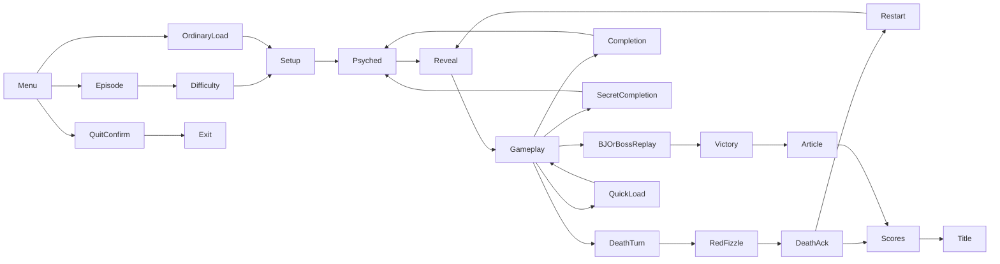

# DOS interaction and state-transition inventory

Scope: registered GOODTIMES WL6 historical source and native SDL3 engine. This is a reviewed directed-route inventory, not an exhaustive enumeration of every branch/input combination.
Evidence records distinguish source review, native regression assertions and execution of the checksum-verified original DOS executable. Current run results are in [Milestone 13](MILESTONE13_FINAL_FIDELITY.md).

## How to read the evidence

- **source-reviewed**: Source correspondence inspected; no runtime or pixel-equivalence claim.
- **partial**: Known intentional difference or verification gap remains; see linked findings.

Inventory: **46 phases, 106 directed transition records**, all **28 native UI states** and **10 DOS exit values** accounted for.

A linked test is evidence only for its stated assertions. It does not prove the complete transition, DOS fade/audio equivalence, or a continuous playthrough. This audit adds no new runtime pass claims.

## Principal journeys



The graph describes DOS routes. In particular, death restart bypasses Get Psyched, and established-slot quickload returns to the existing play loop. Differences below remain open.

- **New game**: title → menu → episode → difficulty → setup → psyched → psyched → reveal → gameplay. Rows: title-menu, menu-episode, episode-difficulty, difficulty-setup, setup-psyched, psyched-progress, psyched-reveal, reveal-game.
- **Death restart**: gameplay → death-turn → red-fizzle → death-ack → restart → gameplay. Rows: death-turn, death-fizzle, death-ack, death-restart, restart-reveal.
- **Final death**: gameplay → death-turn → red-fizzle → death-ack → qualification → name-entry → title. Rows: death-turn, death-fizzle, death-ack, death-final, qualify, name-save.
- **Secret floor**: gameplay → secret-completion → setup → psyched → reveal → gameplay. Rows: secret-completion, secret-entry, setup-psyched, psyched-reveal, reveal-game.
- **Ordinary load**: menu → load → disk → setup → psyched → reveal → gameplay. Rows: menu-load, load-work, ordinary-load-setup, setup-psyched, psyched-reveal, reveal-game.
- **Established quickload**: gameplay → quick-confirm → quick-disk → gameplay. Rows: quickload-confirm, quickload-yes, quick-resume.
- **Victory**: gameplay → boss-replay → victory → article → qualification → results → title. Rows: boss-victory, victory-stats, victory-article, article-scores, not-qualified, results-title.
- **Quit**: menu → quit-confirm → exit. Rows: quit-menu, quit-yes.
- **Startup/attract**: process → signon → rating → title → credits → attract-scores → demo → title. Rows: startup, signon-ack, rating-title, title-credits, credits-scores, scores-demo, demo-title.
- **End Game**: gameplay → end-confirm → death-turn → red-fizzle → death-ack → qualification → results → title. Rows: end-game, end-yes, death-fizzle, death-ack, death-final, not-qualified, results-title.

## Findings that prevent a DOS-equivalence claim

### presentation — P1: Continuous executed-DOS comparison incomplete

30 controlled indexed frames and four sound-off demo state traces do not establish all intermediate fades, gameplay composites, victory/article/name-entry or death frames.

Source/implementation: [PreloadGraphics](../WOLFSRC/WL_INTER.C#L965); [StepPreloadGraphics](../src/engine/WL_INTER.c#L252)

Rows: startup, signon-ack, rating-title, title-credits, credits-scores, scores-demo, demo-title, title-menu, credits-menu, attract-scores-menu, demo-menu, menu-episode, episode-difficulty, episode-replace, replace-yes, replace-no, difficulty-setup, episode-back, difficulty-back, setup-psyched, psyched-progress, psyched-reveal, reveal-game, game-pause, pause-game, game-menu, menu-game, save-panel, load-panel, menu-save, menu-load, save-work, load-work, ordinary-load-setup, save-return, save-cancel, load-cancel, quicksave, quickload-confirm, quickload-yes, quickload-no, quick-resume, message-return, death-turn, death-fizzle, death-ack, death-restart, restart-reveal, death-final, exit-completion, secret-completion, next-setup, secret-entry, secret-return, boss-victory, victory-stats, victory-article, article-scores, qualify, not-qualified, name-save, results-title, quit-menu, quit-game, quit-no, quit-yes, panel-sound, return-sound, panel-view, return-view, jukebox, jukebox-return, warp-setup, menu-scores, scores-menu, menu-attract, game-sound, sound-game, game-view, view-game, save-cancel-game, load-cancel-game, quit-no-game, end-game, end-menu, end-yes, end-no, end-no-menu.

Close with: Capture synchronized original DOS intermediate framebuffer/palette/input/audio records for these journeys.

### cache — P2: Native cache and I/O cadence

Native heap residency and bounded reads replace DOS main/EMS/XMS budgets and disk speed; exact page counts and duration differ.

Source/implementation: [PM_Preload](../WOLFSRC/ID_PM.C#L943); [StepPreloadGraphics](../src/engine/WL_INTER.c#L252)

Rows: setup-psyched, psyched-progress, psyched-reveal.

Close with: Treat as intentional adaptation; compare visual progress formula separately from hardware-dependent duration.

### entry-fizzle — P1: Gameplay-entry reveal differs

DOS GameLoop sets fizzlein; Revive uses a 30-tic palette fade after loading and redraws immediately on death restart. Neither reproduces DOS ThreeDRefresh/FizzleFade gameplay-entry reveal. This is an acknowledged visual difference, not pixel parity.

Source/implementation: [GameLoop](../WOLFSRC/WL_GAME.C#L45); [StepPreloadGraphics](../src/engine/WL_INTER.c#L252)

Rows: psyched-reveal, reveal-game, restart-reveal.

Close with: Implement and independently compare DOS entry fizzle before claiming complete presentation equivalence.

### fizzle-clip — P2: Safe red-fizzle clipping

Revive clips to the active viewport; DOS FizzleFade accepts x==width/y==height and can overdraw border pixels.

Source/implementation: [FizzleFade](../WOLFSRC/ID_VH.C#L462); [Died](../src/engine/WL_PLAY.c#L81)

Rows: death-fizzle.

Close with: Retain safe clipping as an intentional difference unless a bounded compatible renderer is separately demonstrated.

### storage — P2: Portable storage/error flows

Six versioned atomic native saves and separate score/config files replace DOS ten-slot formats. Native I/O/error and disk-flip phases differ.

Source/implementation: [CP_LoadGame](../WOLFSRC/WL_MENU.C#L69); [GameRestoreClock](../src/engine/WL_PLAY.c#L236)

Rows: save-panel, load-panel, menu-save, menu-load, save-work, load-work, ordinary-load-setup, save-return, save-cancel, load-cancel, quicksave, quickload-confirm, quickload-yes, quick-resume, storage-error, name-save, asset-error, error-menu, save-cancel-game, load-cancel-game, preload-error, save-error.

Close with: Document compatibility boundary; keep corruption, atomic failure and restart regressions passing.

### hardware — P2: Portable hardware, input and debug adaptations

No ISA/gameport/EMS/XMS detection, BIOS text mode, controller calibration or DOS timing/cache debug emulation. Native display/binding panels and startup plumbing differ.

Source/implementation: [IntroScreen](../WOLFSRC/WL_MENU.C#L2882); [DemoLoopStartupDevices](../src/engine/WL_MAIN.c#L26)

Rows: startup, quit-yes, panel-controls, return-controls, panel-display, return-display, panel-boss, return-boss, jukebox, debug-warp, cheat-message, game-controls, controls-game, game-boss, boss-game, window-close.

Close with: Document unsupported hardware/editions and verify actual native devices separately.

### ui-rng — P2: Separate UI entropy

Quit-message selection uses separate native UI entropy, preserving gameplay/demo RNG rather than consuming original US_RndT.

Source/implementation: [CP_Quit](../WOLFSRC/WL_MENU.C#L492); [QuitMessage](../src/engine/WL_MAIN.c#L35)

Rows: quit-menu, quit-game.

Close with: Retain intentional separation and test original saying selection precedence independently.

### audio — P1: Physical FM/PCM balance unverified

The current wide-accumulator ×4 FM gain, synth and native volume controls are not calibrated against physical OPL/Sound Blaster output. Scheduling/priority tests do not establish loudness parity. DOS UpdateFace skips RNG while GETGATLINGSND is playing; the native engine intentionally retains audio-independent face/RNG updates. The four reference demos use DOS sound off.

Source/implementation: [CP_Sound](../WOLFSRC/WL_MENU.C#L67); [BeginSoundSettings](../src/engine/WL_MENU.c#L246)

Rows: panel-sound, return-sound, game-sound, sound-game.

Close with: Measure representative enabled-DOS tracks/effects against a documented device/reference before changing gain.

## Transition records

### Startup

#### startup: process → signon

**Trigger:** Initialize subsystems and optional SIGNON.RAW **Status:** `partial`.

- **DOS source:** [InitGame](../WOLFSRC/WL_MAIN.C#L1138); [IntroScreen](../WOLFSRC/WL_MENU.C#L2882)
- **Timing:** Native initialization; optional sign-on 10-tic fade.
- **Palette:** Original gamepal indices; VGA-style DAC interpolation where faded.
- **Artwork/layout:** Owned 320×200 sign-on; actual mouse/audio capability lights.
- **Sound/music:** Silent sign-on.
- **Input/state:** Fresh key acknowledges; M enters jukebox.
- **Revive:** [DemoLoopStartupDevices](../src/engine/WL_MAIN.c#L26); [DemoLoopSignon](../src/engine/WL_MAIN.c#L154)
- **Regression evidence:** [signon](#signon). Open findings: hardware, presentation.

#### signon-ack: signon → rating

**Trigger:** FinishSignon acknowledgement **Status:** `partial`.

- **DOS source:** [FinishSignon](../WOLFSRC/WL_MAIN.C#L760); [PG13](../WOLFSRC/WL_INTER.C#L305)
- **Timing:** 30-tic black fade with original gamepal reveal; simulation frozen.
- **Palette:** Original gamepal indices; VGA-style DAC interpolation where faded.
- **Artwork/layout:** Original Working prompt then PG13 at (216,110).
- **Sound/music:** Title music 7 begins on rating/title boundary.
- **Input/state:** Clear acknowledging input.
- **Revive:** [SignonPrompt](../src/engine/WL_MAIN.c#L142); [DemoLoopIntro](../src/engine/WL_MAIN.c#L180)
- **Regression evidence:** [signon](#signon). Open findings: presentation.

### Attract

#### rating-title: rating → title

**Trigger:** Seven seconds or fresh input **Status:** `partial`.

- **DOS source:** [PG13](../WOLFSRC/WL_INTER.C#L305); [DemoLoop](../WOLFSRC/WL_MAIN.C#L1404)
- **Timing:** 7×70-tic hold, 30-tic black fade.
- **Palette:** Original gamepal indices; VGA-style DAC interpolation where faded.
- **Artwork/layout:** PG13 to TITLEPIC.
- **Sound/music:** Track 7.
- **Input/state:** Fresh input skips rating.
- **Revive:** [StepDemoLoop](../src/engine/WL_MAIN.c#L301)
- **Regression evidence:** [signon](#signon). Open findings: presentation.

#### title-credits: title → credits

**Trigger:** Attract deadline **Status:** `partial`.

- **DOS source:** [DemoLoop](../WOLFSRC/WL_MAIN.C#L1404); [PlayDemo](../WOLFSRC/WL_GAME.C#L1037)
- **Timing:** 15×70 tics plus 30-tic black fades.
- **Palette:** Original gamepal indices; VGA-style DAC interpolation where faded.
- **Artwork/layout:** TITLEPIC → CREDITSPIC
- **Sound/music:** Title/score/level tracks selected at boundaries.
- **Input/state:** Any fresh key/click opens menu.
- **Revive:** [ChangeScreen](../src/engine/WL_MAIN.c#L66); [StepDemoLoop](../src/engine/WL_MAIN.c#L301)
- **Regression evidence:** [demo](#demo). Open findings: presentation.

#### credits-scores: credits → attract-scores

**Trigger:** Attract deadline **Status:** `partial`.

- **DOS source:** [DemoLoop](../WOLFSRC/WL_MAIN.C#L1404); [PlayDemo](../WOLFSRC/WL_GAME.C#L1037)
- **Timing:** 10×70 tics plus 30-tic black fades.
- **Palette:** Original gamepal indices; VGA-style DAC interpolation where faded.
- **Artwork/layout:** CREDITSPIC → HIGHSCORESPIC
- **Sound/music:** Title/score/level tracks selected at boundaries.
- **Input/state:** Any fresh key/click opens menu.
- **Revive:** [ChangeScreen](../src/engine/WL_MAIN.c#L66); [StepDemoLoop](../src/engine/WL_MAIN.c#L301)
- **Regression evidence:** [demo](#demo). Open findings: presentation.

#### scores-demo: attract-scores → demo

**Trigger:** Attract deadline **Status:** `partial`.

- **DOS source:** [DemoLoop](../WOLFSRC/WL_MAIN.C#L1404); [PlayDemo](../WOLFSRC/WL_GAME.C#L1037)
- **Timing:** 10×70 tics plus 30-tic black fades.
- **Palette:** Original gamepal indices; VGA-style DAC interpolation where faded.
- **Artwork/layout:** Scores → original demo overlay
- **Sound/music:** Title/score/level tracks selected at boundaries.
- **Input/state:** Any fresh key/click opens menu.
- **Revive:** [ChangeScreen](../src/engine/WL_MAIN.c#L66); [StepDemoLoop](../src/engine/WL_MAIN.c#L301)
- **Regression evidence:** [demo](#demo). Open findings: presentation.

#### demo-title: demo → title

**Trigger:** Demo ends/dies/exits or cannot start **Status:** `partial`.

- **DOS source:** [PlayDemo](../WOLFSRC/WL_GAME.C#L1037); [DemoLoop](../WOLFSRC/WL_MAIN.C#L1404)
- **Timing:** 30-tic black fade with original gamepal reveal; simulation frozen.
- **Palette:** Original gamepal indices; VGA-style DAC interpolation where faded.
- **Artwork/layout:** Game → TITLEPIC.
- **Sound/music:** Stop level music; title music.
- **Input/state:** Demo commands isolated from live bindings.
- **Revive:** [StepDemoLoop](../src/engine/WL_MAIN.c#L301)
- **Regression evidence:** [demo](#demo). Open findings: presentation.

#### title-menu: title → menu

**Trigger:** Fresh key or mouse **Status:** `partial`.

- **DOS source:** [DemoLoop](../WOLFSRC/WL_MAIN.C#L1404); [US_ControlPanel](../WOLFSRC/WL_MENU.C#L332)
- **Timing:** 30-tic black fade with original gamepal reveal; simulation frozen.
- **Palette:** Original gamepal indices; VGA-style DAC interpolation where faded.
- **Artwork/layout:** Original control-panel artwork.
- **Sound/music:** Menu track 14.
- **Input/state:** Abort demo and release its game resources.
- **Revive:** [StepDemoLoop](../src/engine/WL_MAIN.c#L301)
- **Regression evidence:** [classic](#classic), [demo](#demo). Open findings: presentation.

#### credits-menu: credits → menu

**Trigger:** Fresh key or mouse **Status:** `partial`.

- **DOS source:** [DemoLoop](../WOLFSRC/WL_MAIN.C#L1404); [US_ControlPanel](../WOLFSRC/WL_MENU.C#L332)
- **Timing:** 30-tic black fade with original gamepal reveal; simulation frozen.
- **Palette:** Original gamepal indices; VGA-style DAC interpolation where faded.
- **Artwork/layout:** Original control-panel artwork.
- **Sound/music:** Menu track 14.
- **Input/state:** Abort demo and release its game resources.
- **Revive:** [StepDemoLoop](../src/engine/WL_MAIN.c#L301)
- **Regression evidence:** [classic](#classic), [demo](#demo). Open findings: presentation.

#### attract-scores-menu: attract-scores → menu

**Trigger:** Fresh key or mouse **Status:** `partial`.

- **DOS source:** [DemoLoop](../WOLFSRC/WL_MAIN.C#L1404); [US_ControlPanel](../WOLFSRC/WL_MENU.C#L332)
- **Timing:** 30-tic black fade with original gamepal reveal; simulation frozen.
- **Palette:** Original gamepal indices; VGA-style DAC interpolation where faded.
- **Artwork/layout:** Original control-panel artwork.
- **Sound/music:** Menu track 14.
- **Input/state:** Abort demo and release its game resources.
- **Revive:** [StepDemoLoop](../src/engine/WL_MAIN.c#L301)
- **Regression evidence:** [classic](#classic), [demo](#demo). Open findings: presentation.

#### demo-menu: demo → menu

**Trigger:** Fresh key or mouse **Status:** `partial`.

- **DOS source:** [DemoLoop](../WOLFSRC/WL_MAIN.C#L1404); [US_ControlPanel](../WOLFSRC/WL_MENU.C#L332)
- **Timing:** 30-tic black fade with original gamepal reveal; simulation frozen.
- **Palette:** Original gamepal indices; VGA-style DAC interpolation where faded.
- **Artwork/layout:** Original control-panel artwork.
- **Sound/music:** Menu track 14.
- **Input/state:** Abort demo and release its game resources.
- **Revive:** [StepDemoLoop](../src/engine/WL_MAIN.c#L301)
- **Regression evidence:** [classic](#classic), [demo](#demo). Open findings: presentation.

### New game

#### menu-episode: menu → episode

**Trigger:** Choose New Game **Status:** `partial`.

- **DOS source:** [CP_NewGame](../WOLFSRC/WL_MENU.C#L66)
- **Timing:** 10-tic menu dark-red fade (43,0,0); simulation frozen.
- **Palette:** Original gamepal indices; VGA-style DAC interpolation where faded.
- **Artwork/layout:** Episode artwork and six rows.
- **Sound/music:** Menu selection sound. 
- **Input/state:** Fresh arrows/hotkeys/Enter/Space; Escape returns; clear pending gameplay input.
- **Revive:** [StepDemoLoop](../src/engine/WL_MAIN.c#L301); [DrawNewSelection](../src/engine/WL_MENU.c#L160)
- **Regression evidence:** [classic](#classic). Open findings: presentation.

#### episode-difficulty: episode → difficulty

**Trigger:** Accept episode without active game **Status:** `partial`.

- **DOS source:** [CP_NewGame](../WOLFSRC/WL_MENU.C#L66)
- **Timing:** 10-tic menu dark-red fade (43,0,0); simulation frozen.
- **Palette:** Original gamepal indices; VGA-style DAC interpolation where faded.
- **Artwork/layout:** Difficulty artwork/BJ faces.
- **Sound/music:** Menu sounds.
- **Input/state:** Fresh arrows/hotkeys/Enter/Space; Escape returns; clear pending gameplay input.
- **Revive:** [StepDemoLoop](../src/engine/WL_MAIN.c#L301)
- **Regression evidence:** [classic](#classic). Open findings: presentation.

#### episode-replace: episode → replace-confirm

**Trigger:** Accept episode while game active **Status:** `partial`.

- **DOS source:** [CP_NewGame](../WOLFSRC/WL_MENU.C#L66)
- **Timing:** 20-tic cursor blink; answer release.
- **Palette:** Original gamepal indices; VGA-style DAC interpolation where faded.
- **Artwork/layout:** CURGAME message and blinking cursor.
- **Sound/music:** ESCPRESSEDSND / SHOOTSND by confirmation.
- **Input/state:** Y/N/Escape; gameplay frozen.
- **Revive:** [QuickDialog](../src/engine/WL_MAIN.c#L193)
- **Regression evidence:** [classic](#classic), [dos-pixels](#dos-pixels). Open findings: presentation.

#### replace-yes: replace-confirm → difficulty

**Trigger:** Y released **Status:** `partial`.

- **DOS source:** [CP_NewGame](../WOLFSRC/WL_MENU.C#L66); [Confirm](../WOLFSRC/WL_MENU.C#L664)
- **Timing:** 10-tic menu dark-red fade (43,0,0); simulation frozen.
- **Palette:** Original gamepal indices; VGA-style DAC interpolation where faded.
- **Artwork/layout:** Restore destination selection.
- **Sound/music:** Confirmation sounds.
- **Input/state:** Keep quick slot until difficulty accepted.
- **Revive:** [StepDemoLoop](../src/engine/WL_MAIN.c#L301)
- **Regression evidence:** [classic](#classic). Open findings: presentation.

#### replace-no: replace-confirm → menu

**Trigger:** N/Escape **Status:** `partial`.

- **DOS source:** [CP_NewGame](../WOLFSRC/WL_MENU.C#L66); [Confirm](../WOLFSRC/WL_MENU.C#L664)
- **Timing:** 10-tic menu dark-red fade (43,0,0); simulation frozen.
- **Palette:** Original gamepal indices; VGA-style DAC interpolation where faded.
- **Artwork/layout:** Restore destination selection.
- **Sound/music:** Confirmation sounds.
- **Input/state:** Keep quick slot until difficulty accepted.
- **Revive:** [StepDemoLoop](../src/engine/WL_MAIN.c#L301)
- **Regression evidence:** [classic](#classic). Open findings: presentation.

#### difficulty-setup: difficulty → setup

**Trigger:** Accept difficulty **Status:** `partial`.

- **DOS source:** [CP_NewGame](../WOLFSRC/WL_MENU.C#L66); [SetupGameLevel](../WOLFSRC/WL_GAME.C#L42)
- **Timing:** Setup while simulation blocked.
- **Palette:** Original gamepal indices; VGA-style DAC interpolation where faded.
- **Artwork/layout:** Play border, status bar, first floor.
- **Sound/music:** Start level music.
- **Input/state:** Reset quick slot and input.
- **Revive:** [ChangeScreen](../src/engine/WL_MAIN.c#L66); [GameStartSelected](../src/engine/WL_PLAY.c#L52)
- **Regression evidence:** [campaign](#campaign), [classic](#classic). Open findings: presentation.

#### episode-back: episode → menu

**Trigger:** Escape **Status:** `partial`.

- **DOS source:** [CP_NewGame](../WOLFSRC/WL_MENU.C#L66)
- **Timing:** 10-tic menu dark-red fade (43,0,0); simulation frozen.
- **Palette:** Original gamepal indices; VGA-style DAC interpolation where faded.
- **Artwork/layout:** Restore parent artwork.
- **Sound/music:** Escape sound.
- **Input/state:** Fresh arrows/hotkeys/Enter/Space; Escape returns; clear pending gameplay input.
- **Revive:** [StepDemoLoop](../src/engine/WL_MAIN.c#L301)
- **Regression evidence:** [classic](#classic). Open findings: presentation.

#### difficulty-back: difficulty → episode

**Trigger:** Escape **Status:** `partial`.

- **DOS source:** [CP_NewGame](../WOLFSRC/WL_MENU.C#L66)
- **Timing:** 10-tic menu dark-red fade (43,0,0); simulation frozen.
- **Palette:** Original gamepal indices; VGA-style DAC interpolation where faded.
- **Artwork/layout:** Restore parent artwork.
- **Sound/music:** Escape sound.
- **Input/state:** Fresh arrows/hotkeys/Enter/Space; Escape returns; clear pending gameplay input.
- **Revive:** [StepDemoLoop](../src/engine/WL_MAIN.c#L301)
- **Regression evidence:** [classic](#classic). Open findings: presentation.

### Loading

#### setup-psyched: setup → psyched

**Trigger:** New level, ordinary load, warp or secret routing **Status:** `partial`.

- **DOS source:** [GameLoop](../WOLFSRC/WL_GAME.C#L45); [PreloadGraphics](../WOLFSRC/WL_INTER.C#L965)
- **Timing:** 30-tic fade in, real uncached page reads (≤32 per frontend update).
- **Palette:** Original gamepal indices; VGA-style DAC interpolation where faded.
- **Artwork/layout:** GETPSYCHEDPIC (48,56), index 127 background; retained HUD.
- **Sound/music:** Level music continues.
- **Input/state:** Block simulation and input.
- **Revive:** [StartPreloadGraphics](../src/engine/WL_INTER.c#L242)
- **Regression evidence:** [loading](#loading), [dos-pixels](#dos-pixels). Open findings: cache, presentation.

#### psyched-progress: psyched → psyched

**Trigger:** Each successfully cached non-sparse page **Status:** `partial`.

- **DOS source:** [PreloadUpdate](../WOLFSRC/WL_INTER.C#L972); [PM_Preload](../WOLFSRC/ID_PM.C#L943)
- **Timing:** Only actual uncached pages advance; no artificial minimum.
- **Palette:** Original gamepal indices; VGA-style DAC interpolation where faded.
- **Artwork/layout:** 214×2 bar (53,101); black remainder, 0x37 fill, 0x32 highlight except last column.
- **Sound/music:** Level track.
- **Input/state:** No Escape cancellation in DOS callback.
- **Revive:** [PreloadUpdate](../src/engine/WL_INTER.c#L221); [StepPreloadGraphics](../src/engine/WL_INTER.c#L252)
- **Regression evidence:** [loading](#loading), [dos-pixels](#dos-pixels). Open findings: cache, presentation.

#### psyched-reveal: psyched → reveal

**Trigger:** Cache complete then fresh acknowledgement or timeout **Status:** `partial`.

- **DOS source:** [PreloadGraphics](../WOLFSRC/WL_INTER.C#L965)
- **Timing:** 70-tic wait, 30-tic fade out; gameplay geometry selected while black.
- **Palette:** Original gamepal indices; VGA-style DAC interpolation where faded.
- **Artwork/layout:** Restore bevel and game view while black.
- **Sound/music:** Level track.
- **Input/state:** Discard earlier presses; require fresh acknowledgement.
- **Revive:** [StepPreloadGraphics](../src/engine/WL_INTER.c#L252)
- **Regression evidence:** [loading](#loading). Open findings: cache, entry-fizzle, presentation.

#### reveal-game: reveal → gameplay

**Trigger:** Reveal completes **Status:** `partial`.

- **DOS source:** [PlayLoop](../WOLFSRC/WL_PLAY.C#L91); [GameLoop](../WOLFSRC/WL_GAME.C#L45)
- **Timing:** Native 30-tic palette reveal replaces DOS entry fizzle.
- **Palette:** Original gamepal indices; VGA-style DAC interpolation where faded.
- **Artwork/layout:** Current viewport/HUD, Enhanced geometry fixed before visible frame.
- **Sound/music:** Level track.
- **Input/state:** Clear keys; reset simulation clock before control capture.
- **Revive:** [StepPreloadGraphics](../src/engine/WL_INTER.c#L252); [StepDemoLoop](../src/engine/WL_MAIN.c#L301)
- **Regression evidence:** [loading](#loading). Open findings: entry-fizzle, presentation.

### Pause

#### game-pause: gameplay → pause

**Trigger:** Pause key **Status:** `partial`.

- **DOS source:** [CheckKeys](../WOLFSRC/WL_PLAY.C#L609)
- **Timing:** Immediate picture; freeze simulation.
- **Palette:** Original gamepal indices; VGA-style DAC interpolation where faded.
- **Artwork/layout:** PAUSEDPIC at (128,64) over game.
- **Sound/music:** SD_MusicOff; native preserves stream position.
- **Input/state:** Fresh acknowledgement only.
- **Revive:** [StepDemoLoop](../src/engine/WL_MAIN.c#L301)
- **Regression evidence:** [classic](#classic), [dos-pixels](#dos-pixels). Open findings: presentation.

#### pause-game: pause → gameplay

**Trigger:** Fresh key **Status:** `partial`.

- **DOS source:** [CheckKeys](../WOLFSRC/WL_PLAY.C#L609)
- **Timing:** Clock rebased; no catch-up.
- **Palette:** Original gamepal indices; VGA-style DAC interpolation where faded.
- **Artwork/layout:** Redraw game without overlay.
- **Sound/music:** Restore prior paused state.
- **Input/state:** Clear ack and held input.
- **Revive:** [StepDemoLoop](../src/engine/WL_MAIN.c#L301)
- **Regression evidence:** [classic](#classic). Open findings: presentation.

#### game-menu: gameplay → menu

**Trigger:** Escape **Status:** `partial`.

- **DOS source:** [CheckKeys](../WOLFSRC/WL_PLAY.C#L609); [US_ControlPanel](../WOLFSRC/WL_MENU.C#L332)
- **Timing:** 10-tic menu dark-red fade (43,0,0); simulation frozen.
- **Palette:** Original gamepal indices; VGA-style DAC interpolation where faded.
- **Artwork/layout:** Original menu on 4:3 interface canvas.
- **Sound/music:** Menu track.
- **Input/state:** Freeze gameplay; clear input.
- **Revive:** [Transition](../src/engine/WL_MAIN.c#L121)
- **Regression evidence:** [classic](#classic). Open findings: presentation.

#### menu-game: menu → gameplay

**Trigger:** Back to Game **Status:** `partial`.

- **DOS source:** [US_ControlPanel](../WOLFSRC/WL_MENU.C#L332)
- **Timing:** 10-tic menu dark-red fade (43,0,0); simulation frozen.
- **Palette:** Original gamepal indices; VGA-style DAC interpolation where faded.
- **Artwork/layout:** Restore viewport/HUD.
- **Sound/music:** Restore level track.
- **Input/state:** Reset simulation clock.
- **Revive:** [ChangeScreen](../src/engine/WL_MAIN.c#L66)
- **Regression evidence:** [classic](#classic). Open findings: presentation.

### Storage

#### save-panel: gameplay → save

**Trigger:** F2 or menu Save **Status:** `partial`.

- **DOS source:** [CP_SaveGame](../WOLFSRC/WL_MENU.C#L70)
- **Timing:** 10-tic menu dark-red fade (43,0,0); simulation frozen.
- **Palette:** Original gamepal indices; VGA-style DAC interpolation where faded.
- **Artwork/layout:** Original Saving/Loading slot artwork with six portable slots.
- **Sound/music:** Menu music/cursor sounds.
- **Input/state:** Saving restricted to living playable game.
- **Revive:** [StepDemoLoop](../src/engine/WL_MAIN.c#L301)
- **Regression evidence:** [save](#save), [classic](#classic). Open findings: storage, presentation.

#### load-panel: gameplay → load

**Trigger:** F3 or menu Load **Status:** `partial`.

- **DOS source:** [CP_LoadGame](../WOLFSRC/WL_MENU.C#L69)
- **Timing:** 10-tic menu dark-red fade (43,0,0); simulation frozen.
- **Palette:** Original gamepal indices; VGA-style DAC interpolation where faded.
- **Artwork/layout:** Original Saving/Loading slot artwork with six portable slots.
- **Sound/music:** Menu music/cursor sounds.
- **Input/state:** Saving restricted to living playable game.
- **Revive:** [StepDemoLoop](../src/engine/WL_MAIN.c#L301)
- **Regression evidence:** [save](#save), [classic](#classic). Open findings: storage, presentation.

#### menu-save: menu → save

**Trigger:** Save row **Status:** `partial`.

- **DOS source:** [CP_SaveGame](../WOLFSRC/WL_MENU.C#L70)
- **Timing:** 10-tic menu dark-red fade (43,0,0); simulation frozen.
- **Palette:** Original gamepal indices; VGA-style DAC interpolation where faded.
- **Artwork/layout:** Original Saving/Loading slot artwork with six portable slots.
- **Sound/music:** Menu music/cursor sounds.
- **Input/state:** Saving restricted to living playable game.
- **Revive:** [StepDemoLoop](../src/engine/WL_MAIN.c#L301)
- **Regression evidence:** [save](#save), [classic](#classic). Open findings: storage, presentation.

#### menu-load: menu → load

**Trigger:** Load row **Status:** `partial`.

- **DOS source:** [CP_LoadGame](../WOLFSRC/WL_MENU.C#L69)
- **Timing:** 10-tic menu dark-red fade (43,0,0); simulation frozen.
- **Palette:** Original gamepal indices; VGA-style DAC interpolation where faded.
- **Artwork/layout:** Original Saving/Loading slot artwork with six portable slots.
- **Sound/music:** Menu music/cursor sounds.
- **Input/state:** Saving restricted to living playable game.
- **Revive:** [StepDemoLoop](../src/engine/WL_MAIN.c#L301)
- **Regression evidence:** [save](#save), [classic](#classic). Open findings: storage, presentation.

#### save-work: save → disk

**Trigger:** Accept slot; edit/overwrite confirmation for save **Status:** `partial`.

- **DOS source:** [CP_SaveGame](../WOLFSRC/WL_MENU.C#L70); [DrawLSAction](../WOLFSRC/WL_MENU.C#L1343)
- **Timing:** Nonblocking presentation phases around synchronous atomic I/O.
- **Palette:** Original gamepal indices; VGA-style DAC interpolation where faded.
- **Artwork/layout:** Original disk window and alternating disk pictures.
- **Sound/music:** Menu effects; loading restores level music.
- **Input/state:** Confirmation answer release; validation errors preserve active game.
- **Revive:** [HandleSaveMenu](../src/engine/WL_SAVE_MENU.c#L73)
- **Regression evidence:** [save](#save), [interface](#interface), [dos-pixels](#dos-pixels). Open findings: storage, presentation.

#### load-work: load → disk

**Trigger:** Accept slot; edit/overwrite confirmation for save **Status:** `partial`.

- **DOS source:** [CP_LoadGame](../WOLFSRC/WL_MENU.C#L69); [DrawLSAction](../WOLFSRC/WL_MENU.C#L1343)
- **Timing:** Nonblocking presentation phases around synchronous atomic I/O.
- **Palette:** Original gamepal indices; VGA-style DAC interpolation where faded.
- **Artwork/layout:** Original disk window and alternating disk pictures.
- **Sound/music:** Menu effects; loading restores level music.
- **Input/state:** Confirmation answer release; validation errors preserve active game.
- **Revive:** [HandleSaveMenu](../src/engine/WL_SAVE_MENU.c#L73)
- **Regression evidence:** [save](#save), [interface](#interface), [dos-pixels](#dos-pixels). Open findings: storage, presentation.

#### ordinary-load-setup: disk → setup

**Trigger:** Ordinary load succeeds **Status:** `partial`.

- **DOS source:** [CP_LoadGame](../WOLFSRC/WL_MENU.C#L69); [GameLoop](../WOLFSRC/WL_GAME.C#L45)
- **Timing:** Ordinary load requests Get Psyched.
- **Palette:** Original gamepal indices; VGA-style DAC interpolation where faded.
- **Artwork/layout:** Retain saved game and current display settings.
- **Sound/music:** Restore saved logical digi mode and level track.
- **Input/state:** Clear input; no gameplay advance.
- **Revive:** [StepDemoLoop](../src/engine/WL_MAIN.c#L301); [GameRestoreClock](../src/engine/WL_PLAY.c#L236)
- **Regression evidence:** [save](#save), [loading](#loading). Open findings: storage, presentation.

#### save-return: disk → gameplay

**Trigger:** Save succeeds **Status:** `partial`.

- **DOS source:** [CP_SaveGame](../WOLFSRC/WL_MENU.C#L70)
- **Timing:** Finish disk phase; resume clock.
- **Palette:** Original gamepal indices; VGA-style DAC interpolation where faded.
- **Artwork/layout:** Redraw game and border.
- **Sound/music:** Level track.
- **Input/state:** No reused save key.
- **Revive:** [StepDemoLoop](../src/engine/WL_MAIN.c#L301)
- **Regression evidence:** [save](#save), [classic](#classic). Open findings: storage, presentation.

#### save-cancel: save → menu

**Trigger:** Escape from ordinary menu operation **Status:** `partial`.

- **DOS source:** [CP_SaveGame](../WOLFSRC/WL_MENU.C#L70)
- **Timing:** 10-tic menu dark-red fade (43,0,0); simulation frozen.
- **Palette:** Original gamepal indices; VGA-style DAC interpolation where faded.
- **Artwork/layout:** Restore caller; F-key caller returns directly to gameplay.
- **Sound/music:** Escape sound.
- **Input/state:** No slot established on cancel.
- **Revive:** [ReturnPanel](../src/engine/WL_MAIN.c#L189)
- **Regression evidence:** [classic](#classic), [save](#save). Open findings: storage, presentation.

#### load-cancel: load → menu

**Trigger:** Escape from ordinary menu operation **Status:** `partial`.

- **DOS source:** [CP_LoadGame](../WOLFSRC/WL_MENU.C#L69)
- **Timing:** 10-tic menu dark-red fade (43,0,0); simulation frozen.
- **Palette:** Original gamepal indices; VGA-style DAC interpolation where faded.
- **Artwork/layout:** Restore caller; F-key caller returns directly to gameplay.
- **Sound/music:** Escape sound.
- **Input/state:** No slot established on cancel.
- **Revive:** [ReturnPanel](../src/engine/WL_MAIN.c#L189)
- **Regression evidence:** [classic](#classic), [save](#save). Open findings: storage, presentation.

#### quicksave: gameplay → quick-disk

**Trigger:** F8 with established valid slot **Status:** `partial`.

- **DOS source:** [CP_CheckQuick](../WOLFSRC/WL_MENU.C#L338)
- **Timing:** Start/work/finish phases; no confirmation.
- **Palette:** Original gamepal indices; VGA-style DAC interpolation where faded.
- **Artwork/layout:** Saving activity window.
- **Sound/music:** Effects; no gameplay advancement.
- **Input/state:** First-use F8 opens ordinary selection instead.
- **Revive:** [QuickSave](../src/engine/WL_MAIN.c#L215)
- **Regression evidence:** [classic](#classic), [interface](#interface). Open findings: storage, presentation.

#### quickload-confirm: gameplay → quick-confirm

**Trigger:** F9 established slot **Status:** `partial`.

- **DOS source:** [CP_CheckQuick](../WOLFSRC/WL_MENU.C#L338)
- **Timing:** Blink/release confirmation.
- **Palette:** Original gamepal indices; VGA-style DAC interpolation where faded.
- **Artwork/layout:** Named quickload message in 160-pixel area.
- **Sound/music:** Confirmation effects.
- **Input/state:** Y/N/Escape; invalid slot opens ordinary selection.
- **Revive:** [QuickDialog](../src/engine/WL_MAIN.c#L193)
- **Regression evidence:** [classic](#classic). Open findings: storage, presentation.

#### quickload-yes: quick-confirm → quick-disk

**Trigger:** Y released **Status:** `partial`.

- **DOS source:** [CP_LoadGame](../WOLFSRC/WL_MENU.C#L69)
- **Timing:** Synchronous validated load during work phase.
- **Palette:** Original gamepal indices; VGA-style DAC interpolation where faded.
- **Artwork/layout:** Loading disk artwork.
- **Sound/music:** Restore level music.
- **Input/state:** Revalidate file at load time.
- **Revive:** [QuickActivity](../src/engine/WL_MAIN.c#L209)
- **Regression evidence:** [classic](#classic), [save](#save). Open findings: storage, presentation.

#### quickload-no: quick-confirm → gameplay

**Trigger:** N/Escape **Status:** `partial`.

- **DOS source:** [CP_CheckQuick](../WOLFSRC/WL_MENU.C#L338)
- **Timing:** 10-tic menu dark-red fade (43,0,0); simulation frozen.
- **Palette:** Original gamepal indices; VGA-style DAC interpolation where faded.
- **Artwork/layout:** Restore gameplay. 
- **Sound/music:** Level track.
- **Input/state:** Preserve active game.
- **Revive:** [StepDemoLoop](../src/engine/WL_MAIN.c#L301)
- **Regression evidence:** [classic](#classic). Open findings: presentation.

#### quick-resume: quick-disk → gameplay

**Trigger:** Established quick operation succeeds **Status:** `partial`.

- **DOS source:** [CP_LoadGame](../WOLFSRC/WL_MENU.C#L69); [CP_CheckQuick](../WOLFSRC/WL_MENU.C#L338)
- **Timing:** Direct play-loop return, clock reset.
- **Palette:** Original gamepal indices; VGA-style DAC interpolation where faded.
- **Artwork/layout:** Restore border/game; no Get Psyched.
- **Sound/music:** Level track.
- **Input/state:** No simulation during disk phases.
- **Revive:** [GamePreloadConsumed](../src/engine/WL_MAIN.c#L449)
- **Regression evidence:** [classic](#classic). Open findings: storage, presentation.

#### storage-error: quick-disk → message

**Trigger:** Load/write fails validation or I/O **Status:** `partial`.

- **DOS source:** [CP_LoadGame](../WOLFSRC/WL_MENU.C#L69)
- **Timing:** Wait for acknowledgement.
- **Palette:** Original gamepal indices; VGA-style DAC interpolation where faded.
- **Artwork/layout:** Native explanatory error message.
- **Sound/music:** No new game sound.
- **Input/state:** Retain active game, file and rankings where supported.
- **Revive:** [QuickDialog](../src/engine/WL_MAIN.c#L193)
- **Regression evidence:** [save](#save), [classic](#classic). Open findings: storage.

#### message-return: message → gameplay

**Trigger:** Fresh key **Status:** `partial`.

- **DOS source:** [CheckKeys](../WOLFSRC/WL_PLAY.C#L609)
- **Timing:** Clock rebase.
- **Palette:** Original gamepal indices; VGA-style DAC interpolation where faded.
- **Artwork/layout:** Redraw game.
- **Sound/music:** Restore level track.
- **Input/state:** Consume acknowledgement.
- **Revive:** [StepDemoLoop](../src/engine/WL_MAIN.c#L301)
- **Regression evidence:** [classic](#classic). Open findings: presentation.

### Death

#### death-turn: gameplay → death-turn

**Trigger:** Health reaches zero or End Game **Status:** `partial`.

- **DOS source:** [Died](../WOLFSRC/WL_GAME.C#L1107)
- **Timing:** 2 degrees/tic; shortest arc; 180° chooses negative; float intermediate atan2.
- **Palette:** Original gamepal indices; VGA-style DAC interpolation where faded.
- **Artwork/layout:** Held weapon sentinel -1; retain HUD weapon icon.
- **Sound/music:** Stop music; PLAYERDEATHSND.
- **Input/state:** Turn/fizzle input discarded.
- **Revive:** [Died](../src/engine/WL_PLAY.c#L81)
- **Regression evidence:** [death](#death), [classic](#classic). Open findings: presentation.

#### death-fizzle: death-turn → red-fizzle

**Trigger:** Attacker angle reached **Status:** `partial`.

- **DOS source:** [Died](../WOLFSRC/WL_GAME.C#L1107); [FizzleFade](../WOLFSRC/ID_VH.C#L462)
- **Timing:** Enter fizzle on final turn tic; 64000/70 candidates per tic.
- **Palette:** Original gamepal indices; VGA-style DAC interpolation where faded.
- **Artwork/layout:** Index 4 with 17-bit polynomial.
- **Sound/music:** Death sound continues.
- **Input/state:** Unabortable fizzle.
- **Revive:** [Died](../src/engine/WL_PLAY.c#L81)
- **Regression evidence:** [death](#death). Open findings: fizzle-clip, presentation.

#### death-ack: red-fizzle → death-ack

**Trigger:** Polynomial completes **Status:** `partial`.

- **DOS source:** [Died](../WOLFSRC/WL_GAME.C#L1107)
- **Timing:** 100-tic wait or fresh ack; native logical sound wait.
- **Palette:** Original gamepal indices; VGA-style DAC interpolation where faded.
- **Artwork/layout:** Red viewport/HUD retained.
- **Sound/music:** Wait for death effect.
- **Input/state:** Clear turn/fizzle presses.
- **Revive:** [Died](../src/engine/WL_PLAY.c#L81)
- **Regression evidence:** [death](#death). Open findings: presentation.

#### death-restart: death-ack → restart

**Trigger:** Lives remain **Status:** `partial`.

- **DOS source:** [Died](../WOLFSRC/WL_GAME.C#L1107); [GameLoop](../WOLFSRC/WL_GAME.C#L45)
- **Timing:** Rebuild same level; skip Get Psyched.
- **Palette:** Original gamepal indices; VGA-style DAC interpolation where faded.
- **Artwork/layout:** Pistol, 100 health, STARTAMMO, no keys; entry score.
- **Sound/music:** Restart level track.
- **Input/state:** Clear held/ack input.
- **Revive:** [Died](../src/engine/WL_PLAY.c#L81)
- **Regression evidence:** [death](#death), [campaign](#campaign). Open findings: presentation.

#### restart-reveal: restart → gameplay

**Trigger:** Level rebuild succeeds **Status:** `partial`.

- **DOS source:** [GameLoop](../WOLFSRC/WL_GAME.C#L45)
- **Timing:** DOS sets fizzlein for the same-floor restart; Revive redraws the game immediately without a separate reveal phase.
- **Palette:** Original gamepal; no native restart fade/fizzle.
- **Artwork/layout:** Original play border/HUD.
- **Sound/music:** Level track.
- **Input/state:** Rebase clock.
- **Revive:** [Died](../src/engine/WL_PLAY.c#L81)
- **Regression evidence:** [death](#death). Open findings: entry-fizzle, presentation.

#### death-final: death-ack → qualification

**Trigger:** Lives become negative **Status:** `partial`.

- **DOS source:** [GameLoop](../WOLFSRC/WL_GAME.C#L45); [CheckHighScore](../WOLFSRC/WL_INTER.C#L1190)
- **Timing:** 30-tic black fade with original gamepal reveal; simulation frozen.
- **Palette:** Original gamepal indices; VGA-style DAC interpolation where faded.
- **Artwork/layout:** No Game Over card in this DOS source.
- **Sound/music:** Score music 23.
- **Input/state:** Clear input.
- **Revive:** [HighScores_Insert](../src/engine/WL_MAIN.c#L379)
- **Regression evidence:** [classic](#classic), [scores](#scores). Open findings: presentation.

### Progression

#### exit-completion: gameplay → completion

**Trigger:** Normal elevator exit **Status:** `partial`.

- **DOS source:** [GameLoop](../WOLFSRC/WL_GAME.C#L45); [LevelCompleted](../WOLFSRC/WL_INTER.C#L413)
- **Timing:** Source-based counters, sound waits and 30-VBL boundaries.
- **Palette:** Original gamepal indices; VGA-style DAC interpolation where faded.
- **Artwork/layout:** Original floor completed, ratios, bonus and BJ breathing.
- **Sound/music:** Completion music/effects.
- **Input/state:** First press skips counts; separate press continues.
- **Revive:** [GameStep](../src/engine/WL_PLAY.c#L98); [StartLevelIntermission](../src/engine/WL_INTER.c#L167)
- **Regression evidence:** [campaign](#campaign). Open findings: presentation.

#### secret-completion: gameplay → secret-completion

**Trigger:** Secret elevator exit **Status:** `partial`.

- **DOS source:** [GameLoop](../WOLFSRC/WL_GAME.C#L45)
- **Timing:** Intermission counters/ack.
- **Palette:** Original gamepal indices; VGA-style DAC interpolation where faded.
- **Artwork/layout:** Normal-floor completion before secret routing.
- **Sound/music:** Completion music/effects.
- **Input/state:** Separate continuation acknowledgement.
- **Revive:** [GameStep](../src/engine/WL_PLAY.c#L98)
- **Regression evidence:** [campaign](#campaign), [loading](#loading). Open findings: presentation.

#### next-setup: completion → setup

**Trigger:** Intermission acknowledged **Status:** `partial`.

- **DOS source:** [GameLoop](../WOLFSRC/WL_GAME.C#L45)
- **Timing:** oldscore updated; setup/preload.
- **Palette:** Original gamepal indices; VGA-style DAC interpolation where faded.
- **Artwork/layout:** Next floor; retain inventory, reset keys.
- **Sound/music:** Next floor music.
- **Input/state:** Clear ack.
- **Revive:** [GameStep](../src/engine/WL_PLAY.c#L98)
- **Regression evidence:** [campaign](#campaign), [loading](#loading). Open findings: presentation.

#### secret-entry: secret-completion → setup

**Trigger:** Intermission acknowledged **Status:** `partial`.

- **DOS source:** [GameLoop](../WOLFSRC/WL_GAME.C#L45)
- **Timing:** Ordinary setup/preload.
- **Palette:** Original gamepal indices; VGA-style DAC interpolation where faded.
- **Artwork/layout:** Route to floor 9 (zero based).
- **Sound/music:** Secret floor track.
- **Input/state:** No input carry.
- **Revive:** [GameStep](../src/engine/WL_PLAY.c#L98)
- **Regression evidence:** [campaign](#campaign), [loading](#loading). Open findings: presentation.

#### secret-return: completion → setup

**Trigger:** Leaving mapon 9 **Status:** `partial`.

- **DOS source:** [ElevatorBackTo](../WOLFSRC/WL_GAME.C#L39); [GameLoop](../WOLFSRC/WL_GAME.C#L45)
- **Timing:** Episode-specific ElevatorBackTo; ordinary preload.
- **Palette:** Original gamepal indices; VGA-style DAC interpolation where faded.
- **Artwork/layout:** Secret floor completed card and 15000 bonus.
- **Sound/music:** Destination track.
- **Input/state:** Separate acknowledgement.
- **Revive:** [GameStep](../src/engine/WL_PLAY.c#L98)
- **Regression evidence:** [campaign](#campaign), [loading](#loading). Open findings: presentation.

### Victory

#### boss-victory: gameplay → boss-replay

**Trigger:** Boss dies / victory tile **Status:** `partial`.

- **DOS source:** [A_StartDeathCam](../WOLFSRC/WL_ACT2.C#L158); [Victory](../WOLFSRC/WL_INTER.C#L103)
- **Timing:** Original actor states; logical digi death delay 140 versus 5 tics.
- **Palette:** Original gamepal indices; VGA-style DAC interpolation where faded.
- **Artwork/layout:** BJ run/jump or boss death-camera/replay by episode.
- **Sound/music:** Boss effects and victory track.
- **Input/state:** No save during cinematic.
- **Revive:** [DeathCameraActive](../src/engine/WL_VICTORY.c#L37); [GameStep](../src/engine/WL_PLAY.c#L98)
- **Regression evidence:** [finale](#finale). Open findings: presentation.

#### victory-stats: boss-replay → victory

**Trigger:** Cinematic finishes **Status:** `partial`.

- **DOS source:** [Victory](../WOLFSRC/WL_INTER.C#L103)
- **Timing:** 30-tic black fade with original gamepal reveal; simulation frozen.
- **Palette:** Original gamepal indices; VGA-style DAC interpolation where faded.
- **Artwork/layout:** YOU WIN, eight-floor averages/time/code and HUD.
- **Sound/music:** Victory track.
- **Input/state:** Fresh acknowledgement.
- **Revive:** [DrawVictory](../src/engine/WL_INTER.c#L104); [GameStep](../src/engine/WL_PLAY.c#L98)
- **Regression evidence:** [finale](#finale). Open findings: presentation.

#### victory-article: victory → article

**Trigger:** Acknowledge victory statistics **Status:** `partial`.

- **DOS source:** [Victory](../WOLFSRC/WL_INTER.C#L103); [EndText](../WOLFSRC/WL_TEXT.C#L800)
- **Timing:** Native page state; DOS layout commands retained.
- **Palette:** Original gamepal indices; VGA-style DAC interpolation where faded.
- **Artwork/layout:** Original ending article text/pictures.
- **Sound/music:** Ending music.
- **Input/state:** Arrows/Enter/PageUp/Down; Escape exits.
- **Revive:** [StartEndText](../src/engine/WL_TEXT.c#L108)
- **Regression evidence:** [finale](#finale). Open findings: presentation.

#### article-scores: article → qualification

**Trigger:** Last page/escape **Status:** `partial`.

- **DOS source:** [EndText](../WOLFSRC/WL_TEXT.C#L800); [GameLoop](../WOLFSRC/WL_GAME.C#L45)
- **Timing:** 30-tic black fade with original gamepal reveal; simulation frozen.
- **Palette:** Original gamepal indices; VGA-style DAC interpolation where faded.
- **Artwork/layout:** Original high-score panel.
- **Sound/music:** Score music 23.
- **Input/state:** Clear article input.
- **Revive:** [StepEndText](../src/engine/WL_TEXT.c#L128); [HighScores_Insert](../src/engine/WL_MAIN.c#L379)
- **Regression evidence:** [finale](#finale), [scores](#scores). Open findings: presentation.

### High scores

#### qualify: qualification → name-entry

**Trigger:** Strict score/floor qualification **Status:** `partial`.

- **DOS source:** [CheckHighScore](../WOLFSRC/WL_INTER.C#L1190); [US_LineInput](../WOLFSRC/ID_US_1.C#L534)
- **Timing:** 30-tic reveal; source editor limits.
- **Palette:** Original gamepal indices; VGA-style DAC interpolation where faded.
- **Artwork/layout:** Seven-entry table, blank inserted name and I-bar.
- **Sound/music:** Score track.
- **Input/state:** 57-character / 100-pixel pre-insertion limits; Enter/Escape.
- **Revive:** [ChangeScreen](../src/engine/WL_MAIN.c#L66); [HighScores_Insert](../src/engine/WL_HIGHSCORES.c#L74)
- **Regression evidence:** [scores](#scores). Open findings: presentation.

#### not-qualified: qualification → results

**Trigger:** No rank **Status:** `partial`.

- **DOS source:** [CheckHighScore](../WOLFSRC/WL_INTER.C#L1190)
- **Timing:** 500-tic hold after 30-tic reveal.
- **Palette:** Original gamepal indices; VGA-style DAC interpolation where faded.
- **Artwork/layout:** Seven-entry table.
- **Sound/music:** Score track.
- **Input/state:** Any fresh key continues.
- **Revive:** [ChangeScreen](../src/engine/WL_MAIN.c#L66)
- **Regression evidence:** [scores](#scores), [classic](#classic). Open findings: presentation.

#### name-save: name-entry → title

**Trigger:** Enter or Escape finishes editor **Status:** `partial`.

- **DOS source:** [CheckHighScore](../WOLFSRC/WL_INTER.C#L1190)
- **Timing:** 30-tic black fade with original gamepal reveal; simulation frozen.
- **Palette:** Original gamepal indices; VGA-style DAC interpolation where faded.
- **Artwork/layout:** Title after entry; Escape keeps inserted blank name.
- **Sound/music:** Title track.
- **Input/state:** Atomic native persistence; failure retains session rankings and reports message.
- **Revive:** [StepDemoLoop](../src/engine/WL_MAIN.c#L301); [HighScores_Save](../src/engine/WL_HIGHSCORES.c#L62)
- **Regression evidence:** [scores](#scores). Open findings: storage, presentation.

#### results-title: results → title

**Trigger:** Timeout/fresh key **Status:** `partial`.

- **DOS source:** [CheckHighScore](../WOLFSRC/WL_INTER.C#L1190); [DemoLoop](../WOLFSRC/WL_MAIN.C#L1404)
- **Timing:** 30-tic black fade with original gamepal reveal; simulation frozen.
- **Palette:** Original gamepal indices; VGA-style DAC interpolation where faded.
- **Artwork/layout:** Title/attract cycle.
- **Sound/music:** Title track.
- **Input/state:** Consume acknowledgement.
- **Revive:** [StepDemoLoop](../src/engine/WL_MAIN.c#L301)
- **Regression evidence:** [scores](#scores), [classic](#classic). Open findings: presentation.

### Quit

#### quit-menu: menu → quit-confirm

**Trigger:** Quit row/Escape or F10 **Status:** `partial`.

- **DOS source:** [CP_Quit](../WOLFSRC/WL_MENU.C#L492); [CP_CheckQuick](../WOLFSRC/WL_MENU.C#L338)
- **Timing:** 20-tic cursor blink; wait for answer release.
- **Palette:** Original gamepal indices; VGA-style DAC interpolation where faded.
- **Artwork/layout:** Nine original sayings; WindowH 200 menu / 160 gameplay.
- **Sound/music:** Confirmation sound.
- **Input/state:** Y/N/Escape, keyboard only; separate UI entropy protects gameplay RNG.
- **Revive:** [QuitMessage](../src/engine/WL_MAIN.c#L35); [QuickDialog](../src/engine/WL_MAIN.c#L193)
- **Regression evidence:** [classic](#classic), [dos-pixels](#dos-pixels). Open findings: ui-rng, presentation.

#### quit-game: gameplay → quit-confirm

**Trigger:** Quit row/Escape or F10 **Status:** `partial`.

- **DOS source:** [CP_Quit](../WOLFSRC/WL_MENU.C#L492); [CP_CheckQuick](../WOLFSRC/WL_MENU.C#L338)
- **Timing:** 20-tic cursor blink; wait for answer release.
- **Palette:** Original gamepal indices; VGA-style DAC interpolation where faded.
- **Artwork/layout:** Nine original sayings; WindowH 200 menu / 160 gameplay.
- **Sound/music:** Confirmation sound.
- **Input/state:** Y/N/Escape, keyboard only; separate UI entropy protects gameplay RNG.
- **Revive:** [QuitMessage](../src/engine/WL_MAIN.c#L35); [QuickDialog](../src/engine/WL_MAIN.c#L193)
- **Regression evidence:** [classic](#classic), [dos-pixels](#dos-pixels). Open findings: ui-rng, presentation.

#### quit-no: quit-confirm → menu

**Trigger:** N/Escape from menu **Status:** `partial`.

- **DOS source:** [CP_Quit](../WOLFSRC/WL_MENU.C#L492)
- **Timing:** Menu redraw/return fade.
- **Palette:** Original gamepal indices; VGA-style DAC interpolation where faded.
- **Artwork/layout:** Restore menu; F10 caller restores gameplay.
- **Sound/music:** Menu or level track.
- **Input/state:** Consume answer.
- **Revive:** [StepDemoLoop](../src/engine/WL_MAIN.c#L301)
- **Regression evidence:** [classic](#classic). Open findings: presentation.

#### quit-yes: quit-confirm → exit

**Trigger:** Y released **Status:** `partial`.

- **DOS source:** [CP_Quit](../WOLFSRC/WL_MENU.C#L492)
- **Timing:** 10-tic fade; portable resource teardown.
- **Palette:** Original gamepal indices; VGA-style DAC interpolation where faded.
- **Artwork/layout:** Menu dark-red fade then SDL shutdown.
- **Sound/music:** Stop music and sound before fade.
- **Input/state:** No reused key; window close exits directly.
- **Revive:** [Transition](../src/engine/WL_MAIN.c#L121)
- **Regression evidence:** [classic](#classic). Open findings: hardware, presentation.

### Other panels

#### panel-sound: menu → sound

**Trigger:** Menu selection or corresponding F key **Status:** `partial`.

- **DOS source:** [CP_Sound](../WOLFSRC/WL_MENU.C#L67)
- **Timing:** 10-tic menu dark-red fade (43,0,0); simulation frozen.
- **Palette:** Original gamepal indices; VGA-style DAC interpolation where faded.
- **Artwork/layout:** Original sound labels plus independent native volumes
- **Sound/music:** Menu effects; boss key mutes music.
- **Input/state:** Fresh arrows/hotkeys/Enter/Space; Escape returns; clear pending gameplay input.
- **Revive:** [BeginSoundSettings](../src/engine/WL_MENU.c#L246)
- **Regression evidence:** [audio](#audio). Open findings: audio, presentation.

#### return-sound: sound → menu

**Trigger:** Escape/accept; direct F-key caller returns to game **Status:** `partial`.

- **DOS source:** [CP_Sound](../WOLFSRC/WL_MENU.C#L67)
- **Timing:** 10-tic menu dark-red fade (43,0,0); simulation frozen.
- **Palette:** Original gamepal indices; VGA-style DAC interpolation where faded.
- **Artwork/layout:** Restore caller.
- **Sound/music:** Restore caller track.
- **Input/state:** Fresh arrows/hotkeys/Enter/Space; Escape returns; clear pending gameplay input.
- **Revive:** [ReturnPanel](../src/engine/WL_MAIN.c#L189)
- **Regression evidence:** [audio](#audio). Open findings: audio, presentation.

#### panel-controls: menu → controls

**Trigger:** Menu selection or corresponding F key **Status:** `partial`.

- **DOS source:** [CP_Control](../WOLFSRC/WL_MENU.C#L68)
- **Timing:** 10-tic menu dark-red fade (43,0,0); simulation frozen.
- **Palette:** Original gamepal indices; VGA-style DAC interpolation where faded.
- **Artwork/layout:** Classic/Modern bindings and mouse settings
- **Sound/music:** Menu effects; boss key mutes music.
- **Input/state:** Fresh arrows/hotkeys/Enter/Space; Escape returns; clear pending gameplay input.
- **Revive:** [BeginControlsMenu](../src/engine/WL_CONTROLS_MENU.c#L99)
- **Regression evidence:** [interface](#interface). Open findings: hardware.

#### return-controls: controls → menu

**Trigger:** Escape/accept; direct F-key caller returns to game **Status:** `partial`.

- **DOS source:** [CP_Control](../WOLFSRC/WL_MENU.C#L68)
- **Timing:** 10-tic menu dark-red fade (43,0,0); simulation frozen.
- **Palette:** Original gamepal indices; VGA-style DAC interpolation where faded.
- **Artwork/layout:** Restore caller.
- **Sound/music:** Restore caller track.
- **Input/state:** Fresh arrows/hotkeys/Enter/Space; Escape returns; clear pending gameplay input.
- **Revive:** [ReturnPanel](../src/engine/WL_MAIN.c#L189)
- **Regression evidence:** [interface](#interface). Open findings: hardware.

#### panel-display: controls → display

**Trigger:** Select native Display settings in Controls **Status:** `partial`.

- **DOS source:** [CP_ChangeView](../WOLFSRC/WL_MENU.C#L71)
- **Timing:** 10-tic menu dark-red fade (43,0,0); simulation frozen.
- **Palette:** Original gamepal indices; VGA-style DAC interpolation where faded.
- **Artwork/layout:** Native output settings, no DOS equivalent
- **Sound/music:** Menu effects; boss key mutes music.
- **Input/state:** Fresh arrows/hotkeys/Enter/Space; Escape returns; clear pending gameplay input.
- **Revive:** [BeginDisplayMenu](../src/engine/WL_DISPLAY.c#L61)
- **Regression evidence:** [loading](#loading). Open findings: hardware.

#### return-display: display → controls

**Trigger:** Escape to Controls **Status:** `partial`.

- **DOS source:** [CP_ChangeView](../WOLFSRC/WL_MENU.C#L71)
- **Timing:** 10-tic menu dark-red fade (43,0,0); simulation frozen.
- **Palette:** Original gamepal indices; VGA-style DAC interpolation where faded.
- **Artwork/layout:** Restore caller.
- **Sound/music:** Restore caller track.
- **Input/state:** Fresh arrows/hotkeys/Enter/Space; Escape returns; clear pending gameplay input.
- **Revive:** [ReturnPanel](../src/engine/WL_MAIN.c#L189)
- **Regression evidence:** [loading](#loading). Open findings: hardware.

#### panel-view: menu → view

**Trigger:** Menu selection or corresponding F key **Status:** `partial`.

- **DOS source:** [CP_ChangeView](../WOLFSRC/WL_MENU.C#L71)
- **Timing:** 10-tic menu dark-red fade (43,0,0); simulation frozen.
- **Palette:** Original gamepal indices; VGA-style DAC interpolation where faded.
- **Artwork/layout:** Original sizes 4–19 and border preview
- **Sound/music:** Menu effects; boss key mutes music.
- **Input/state:** Fresh arrows/hotkeys/Enter/Space; Escape returns; clear pending gameplay input.
- **Revive:** [BeginViewMenu](../src/engine/WL_VIEW.c#L35)
- **Regression evidence:** [classic](#classic). Open findings: presentation.

#### return-view: view → menu

**Trigger:** Escape/accept; direct F-key caller returns to game **Status:** `partial`.

- **DOS source:** [CP_ChangeView](../WOLFSRC/WL_MENU.C#L71)
- **Timing:** 10-tic menu dark-red fade (43,0,0); simulation frozen.
- **Palette:** Original gamepal indices; VGA-style DAC interpolation where faded.
- **Artwork/layout:** Restore caller.
- **Sound/music:** Restore caller track.
- **Input/state:** Fresh arrows/hotkeys/Enter/Space; Escape returns; clear pending gameplay input.
- **Revive:** [ReturnPanel](../src/engine/WL_MAIN.c#L189)
- **Regression evidence:** [classic](#classic). Open findings: presentation.

#### panel-boss: menu → boss

**Trigger:** Menu selection or corresponding F key **Status:** `partial`.

- **DOS source:** [BossKey](../WOLFSRC/WL_MENU.C#L351)
- **Timing:** 10-tic menu dark-red fade (43,0,0); simulation frozen.
- **Palette:** Original gamepal indices; VGA-style DAC interpolation where faded.
- **Artwork/layout:** GOODTIMES C> rendered using game font
- **Sound/music:** Menu effects; boss key mutes music.
- **Input/state:** Fresh arrows/hotkeys/Enter/Space; Escape returns; clear pending gameplay input.
- **Revive:** [ChangeScreen](../src/engine/WL_MAIN.c#L66)
- **Regression evidence:** [classic](#classic). Open findings: hardware.

#### return-boss: boss → menu

**Trigger:** Escape/accept; direct F-key caller returns to game **Status:** `partial`.

- **DOS source:** [BossKey](../WOLFSRC/WL_MENU.C#L351)
- **Timing:** 10-tic menu dark-red fade (43,0,0); simulation frozen.
- **Palette:** Original gamepal indices; VGA-style DAC interpolation where faded.
- **Artwork/layout:** Restore caller.
- **Sound/music:** Restore caller track.
- **Input/state:** Fresh arrows/hotkeys/Enter/Space; Escape returns; clear pending gameplay input.
- **Revive:** [ReturnPanel](../src/engine/WL_MAIN.c#L189)
- **Regression evidence:** [classic](#classic). Open findings: hardware.

### Optional routes

#### jukebox: signon → jukebox

**Trigger:** M held at startup/sign-on or --jukebox **Status:** `partial`.

- **DOS source:** [DoJukebox](../WOLFSRC/WL_MAIN.C#L1015)
- **Timing:** 10-tic menu dark-red fade (43,0,0); simulation frozen.
- **Palette:** Original gamepal indices; VGA-style DAC interpolation where faded.
- **Artwork/layout:** Robert’s Jukebox, three six-song banks.
- **Sound/music:** 18 original track indices.
- **Input/state:** Monotonic bank choice replaces DOS time.
- **Revive:** [DemoLoopJukebox](../src/engine/WL_MAIN.c#L249)
- **Regression evidence:** [hidden](#hidden). Open findings: hardware, presentation.

#### jukebox-return: jukebox → title

**Trigger:** Escape **Status:** `partial`.

- **DOS source:** [DoJukebox](../WOLFSRC/WL_MAIN.C#L1015)
- **Timing:** 10-tic menu dark-red fade (43,0,0); simulation frozen.
- **Palette:** Original gamepal indices; VGA-style DAC interpolation where faded.
- **Artwork/layout:** Title. 
- **Sound/music:** Title music.
- **Input/state:** Clear input.
- **Revive:** [StepDemoLoop](../src/engine/WL_MAIN.c#L301)
- **Regression evidence:** [hidden](#hidden). Open findings: presentation.

#### debug-warp: gameplay → warp

**Trigger:** Unlocked Tab-W **Status:** `partial`.

- **DOS source:** [DebugKeys](../WOLFSRC/WL_DEBUG.C#L27)
- **Timing:** Freeze while editing.
- **Palette:** Original gamepal indices; VGA-style DAC interpolation where faded.
- **Artwork/layout:** Original warp prompt.
- **Sound/music:** Current level track.
- **Input/state:** Validate floors 1–10; Escape cancels.
- **Revive:** [HiddenKeys](../src/engine/WL_MAIN.c#L256)
- **Regression evidence:** [hidden](#hidden). Open findings: hardware.

#### warp-setup: warp → setup

**Trigger:** Valid floor entered **Status:** `partial`.

- **DOS source:** [GameLoop](../WOLFSRC/WL_GAME.C#L45)
- **Timing:** Retain inventory; restore entry score.
- **Palette:** Original gamepal indices; VGA-style DAC interpolation where faded.
- **Artwork/layout:** Ordinary level setup and Get Psyched.
- **Sound/music:** Destination track.
- **Input/state:** Clear input.
- **Revive:** [GameWarp](../src/engine/WL_PLAY.c#L71)
- **Regression evidence:** [hidden](#hidden), [loading](#loading). Open findings: presentation.

#### cheat-message: gameplay → message

**Trigger:** MLI/BAT/debug message **Status:** `partial`.

- **DOS source:** [CheckKeys](../WOLFSRC/WL_PLAY.C#L609); [DebugKeys](../WOLFSRC/WL_DEBUG.C#L27)
- **Timing:** Paused acknowledgement; MLI +42000 tics.
- **Palette:** Original gamepal indices; VGA-style DAC interpolation where faded.
- **Artwork/layout:** Original cheat/debug text.
- **Sound/music:** Current track.
- **Input/state:** MLI clears score, supplies health/ammo/keys/chaingun.
- **Revive:** [HiddenKeys](../src/engine/WL_MAIN.c#L256)
- **Regression evidence:** [hidden](#hidden). Open findings: hardware.

### Errors

#### asset-error: setup → error

**Trigger:** Invalid/missing/corrupt level data **Status:** `partial`.

- **DOS source:** [SetupGameLevel](../WOLFSRC/WL_GAME.C#L42)
- **Timing:** No simulation; release level resources.
- **Palette:** Original gamepal indices; VGA-style DAC interpolation where faded.
- **Artwork/layout:** Native readable error.
- **Sound/music:** Stop level music/effects.
- **Input/state:** Fresh key to menu.
- **Revive:** [GameError](../src/engine/WL_MAIN.c#L53)
- **Regression evidence:** [save](#save). Open findings: storage.

#### error-menu: error → menu

**Trigger:** Fresh key **Status:** `partial`.

- **DOS source:** [Quit](../WOLFSRC/WL_MAIN.C#L65)
- **Timing:** 10-tic menu dark-red fade (43,0,0); simulation frozen.
- **Palette:** Original gamepal indices; VGA-style DAC interpolation where faded.
- **Artwork/layout:** Control panel.
- **Sound/music:** Menu track.
- **Input/state:** Consume error acknowledgement.
- **Revive:** [StepDemoLoop](../src/engine/WL_MAIN.c#L301)
- **Regression evidence:** [classic](#classic). Open findings: storage.

### High scores

#### menu-scores: menu → scores

**Trigger:** View Scores with no active game **Status:** `partial`.

- **DOS source:** [CP_ViewScores](../WOLFSRC/WL_MENU.C#L893)
- **Timing:** 10-tic menu fade; wait for fresh key.
- **Palette:** Original gamepal indices; VGA-style DAC interpolation where faded.
- **Artwork/layout:** CREDITSPIC → HIGHSCORESPIC
- **Sound/music:** Title/score/level tracks selected at boundaries.
- **Input/state:** Fresh key returns to main menu.
- **Revive:** [StepDemoLoop](../src/engine/WL_MAIN.c#L301)
- **Regression evidence:** [classic](#classic), [scores](#scores). Open findings: presentation.

#### scores-menu: scores → menu

**Trigger:** Fresh key **Status:** `partial`.

- **DOS source:** [CheckHighScore](../WOLFSRC/WL_INTER.C#L1190); [DemoLoop](../WOLFSRC/WL_MAIN.C#L1404)
- **Timing:** 10-tic menu fade.
- **Palette:** Original gamepal indices; VGA-style DAC interpolation where faded.
- **Artwork/layout:** Title/attract cycle.
- **Sound/music:** Title track.
- **Input/state:** Consume acknowledgement.
- **Revive:** [StepDemoLoop](../src/engine/WL_MAIN.c#L301)
- **Regression evidence:** [scores](#scores), [classic](#classic). Open findings: presentation.

### Pause

#### menu-attract: menu → title

**Trigger:** Back to Demo with no live game **Status:** `partial`.

- **DOS source:** [US_ControlPanel](../WOLFSRC/WL_MENU.C#L332)
- **Timing:** 10-tic menu dark-red fade (43,0,0); simulation frozen.
- **Palette:** Original gamepal indices; VGA-style DAC interpolation where faded.
- **Artwork/layout:** Original TITLEPIC and restarted attract cycle.
- **Sound/music:** Title track 7.
- **Input/state:** Clear selection input.
- **Revive:** [ChangeScreen](../src/engine/WL_MAIN.c#L66)
- **Regression evidence:** [classic](#classic). Open findings: presentation.

### Other panels

#### game-sound: gameplay → sound

**Trigger:** Corresponding F key during living gameplay **Status:** `partial`.

- **DOS source:** [CP_Sound](../WOLFSRC/WL_MENU.C#L67)
- **Timing:** 10-tic menu dark-red fade (43,0,0); simulation frozen.
- **Palette:** Original gamepal indices; VGA-style DAC interpolation where faded.
- **Artwork/layout:** Original sound labels plus independent native volumes
- **Sound/music:** Menu effects; boss key mutes music.
- **Input/state:** Fresh arrows/hotkeys/Enter/Space; Escape returns; clear pending gameplay input.
- **Revive:** [BeginSoundSettings](../src/engine/WL_MENU.c#L246)
- **Regression evidence:** [audio](#audio). Open findings: audio, presentation.

#### sound-game: sound → gameplay

**Trigger:** Accept/Escape from direct F-key panel **Status:** `partial`.

- **DOS source:** [CP_Sound](../WOLFSRC/WL_MENU.C#L67)
- **Timing:** 10-tic menu dark-red fade (43,0,0); simulation frozen.
- **Palette:** Original gamepal indices; VGA-style DAC interpolation where faded.
- **Artwork/layout:** Restore caller.
- **Sound/music:** Restore caller track.
- **Input/state:** Rebase game clock and clear panel input.
- **Revive:** [ReturnPanel](../src/engine/WL_MAIN.c#L189)
- **Regression evidence:** [audio](#audio). Open findings: audio, presentation.

#### game-controls: gameplay → controls

**Trigger:** Corresponding F key during living gameplay **Status:** `partial`.

- **DOS source:** [CP_Control](../WOLFSRC/WL_MENU.C#L68)
- **Timing:** 10-tic menu dark-red fade (43,0,0); simulation frozen.
- **Palette:** Original gamepal indices; VGA-style DAC interpolation where faded.
- **Artwork/layout:** Classic/Modern bindings and mouse settings
- **Sound/music:** Menu effects; boss key mutes music.
- **Input/state:** Fresh arrows/hotkeys/Enter/Space; Escape returns; clear pending gameplay input.
- **Revive:** [BeginControlsMenu](../src/engine/WL_CONTROLS_MENU.c#L99)
- **Regression evidence:** [interface](#interface). Open findings: hardware.

#### controls-game: controls → gameplay

**Trigger:** Accept/Escape from direct F-key panel **Status:** `partial`.

- **DOS source:** [CP_Control](../WOLFSRC/WL_MENU.C#L68)
- **Timing:** 10-tic menu dark-red fade (43,0,0); simulation frozen.
- **Palette:** Original gamepal indices; VGA-style DAC interpolation where faded.
- **Artwork/layout:** Restore caller.
- **Sound/music:** Restore caller track.
- **Input/state:** Rebase game clock and clear panel input.
- **Revive:** [ReturnPanel](../src/engine/WL_MAIN.c#L189)
- **Regression evidence:** [interface](#interface). Open findings: hardware.

#### game-view: gameplay → view

**Trigger:** Corresponding F key during living gameplay **Status:** `partial`.

- **DOS source:** [CP_ChangeView](../WOLFSRC/WL_MENU.C#L71)
- **Timing:** 10-tic menu dark-red fade (43,0,0); simulation frozen.
- **Palette:** Original gamepal indices; VGA-style DAC interpolation where faded.
- **Artwork/layout:** Original sizes 4–19 and border preview
- **Sound/music:** Menu effects; boss key mutes music.
- **Input/state:** Fresh arrows/hotkeys/Enter/Space; Escape returns; clear pending gameplay input.
- **Revive:** [BeginViewMenu](../src/engine/WL_VIEW.c#L35)
- **Regression evidence:** [classic](#classic). Open findings: presentation.

#### view-game: view → gameplay

**Trigger:** Accept/Escape from direct F-key panel **Status:** `partial`.

- **DOS source:** [CP_ChangeView](../WOLFSRC/WL_MENU.C#L71)
- **Timing:** 10-tic menu dark-red fade (43,0,0); simulation frozen.
- **Palette:** Original gamepal indices; VGA-style DAC interpolation where faded.
- **Artwork/layout:** Restore caller.
- **Sound/music:** Restore caller track.
- **Input/state:** Rebase game clock and clear panel input.
- **Revive:** [ReturnPanel](../src/engine/WL_MAIN.c#L189)
- **Regression evidence:** [classic](#classic). Open findings: presentation.

#### game-boss: gameplay → boss

**Trigger:** Corresponding F key during living gameplay **Status:** `partial`.

- **DOS source:** [BossKey](../WOLFSRC/WL_MENU.C#L351)
- **Timing:** 10-tic menu dark-red fade (43,0,0); simulation frozen.
- **Palette:** Original gamepal indices; VGA-style DAC interpolation where faded.
- **Artwork/layout:** GOODTIMES C> rendered using game font
- **Sound/music:** Menu effects; boss key mutes music.
- **Input/state:** Fresh arrows/hotkeys/Enter/Space; Escape returns; clear pending gameplay input.
- **Revive:** [ChangeScreen](../src/engine/WL_MAIN.c#L66)
- **Regression evidence:** [classic](#classic). Open findings: hardware.

#### boss-game: boss → gameplay

**Trigger:** Accept/Escape from direct F-key panel **Status:** `partial`.

- **DOS source:** [BossKey](../WOLFSRC/WL_MENU.C#L351)
- **Timing:** 10-tic menu dark-red fade (43,0,0); simulation frozen.
- **Palette:** Original gamepal indices; VGA-style DAC interpolation where faded.
- **Artwork/layout:** Restore caller.
- **Sound/music:** Restore caller track.
- **Input/state:** Rebase game clock and clear panel input.
- **Revive:** [ReturnPanel](../src/engine/WL_MAIN.c#L189)
- **Regression evidence:** [classic](#classic). Open findings: hardware.

### Storage

#### save-cancel-game: save → gameplay

**Trigger:** Escape from direct F2 panel **Status:** `partial`.

- **DOS source:** [CP_SaveGame](../WOLFSRC/WL_MENU.C#L70)
- **Timing:** 10-tic menu dark-red fade (43,0,0); simulation frozen.
- **Palette:** Original gamepal indices; VGA-style DAC interpolation where faded.
- **Artwork/layout:** Restore caller; F-key caller returns directly to gameplay.
- **Sound/music:** Escape sound.
- **Input/state:** No slot established on cancel.
- **Revive:** [ReturnPanel](../src/engine/WL_MAIN.c#L189)
- **Regression evidence:** [classic](#classic), [save](#save). Open findings: storage, presentation.

#### load-cancel-game: load → gameplay

**Trigger:** Escape from direct F3 panel **Status:** `partial`.

- **DOS source:** [CP_LoadGame](../WOLFSRC/WL_MENU.C#L69)
- **Timing:** 10-tic menu dark-red fade (43,0,0); simulation frozen.
- **Palette:** Original gamepal indices; VGA-style DAC interpolation where faded.
- **Artwork/layout:** Restore caller; F-key caller returns directly to gameplay.
- **Sound/music:** Escape sound.
- **Input/state:** No slot established on cancel.
- **Revive:** [ReturnPanel](../src/engine/WL_MAIN.c#L189)
- **Regression evidence:** [classic](#classic), [save](#save). Open findings: storage, presentation.

### Quit

#### quit-no-game: quit-confirm → gameplay

**Trigger:** N/Escape from F10 confirmation **Status:** `partial`.

- **DOS source:** [CP_Quit](../WOLFSRC/WL_MENU.C#L492)
- **Timing:** Menu redraw/return fade.
- **Palette:** Original gamepal indices; VGA-style DAC interpolation where faded.
- **Artwork/layout:** Restore live game and border.
- **Sound/music:** Level track.
- **Input/state:** Consume answer.
- **Revive:** [StepDemoLoop](../src/engine/WL_MAIN.c#L301)
- **Regression evidence:** [classic](#classic). Open findings: presentation.

### Death

#### end-game: gameplay → end-confirm

**Trigger:** F7 or End Game row **Status:** `partial`.

- **DOS source:** [CP_EndGame](../WOLFSRC/WL_MENU.C#L864); [CP_CheckQuick](../WOLFSRC/WL_MENU.C#L338)
- **Timing:** Blink/release confirmation.
- **Palette:** Original gamepal indices; VGA-style DAC interpolation where faded.
- **Artwork/layout:** Original ENDGAMESTR message and confirmation cursor.
- **Sound/music:** Confirmation effects.
- **Input/state:** Y/N/Escape; freeze active game.
- **Revive:** [QuickDialog](../src/engine/WL_MAIN.c#L193)
- **Regression evidence:** [classic](#classic). Open findings: presentation.

#### end-menu: menu → end-confirm

**Trigger:** F7 or End Game row **Status:** `partial`.

- **DOS source:** [CP_EndGame](../WOLFSRC/WL_MENU.C#L864); [CP_CheckQuick](../WOLFSRC/WL_MENU.C#L338)
- **Timing:** Blink/release confirmation.
- **Palette:** Original gamepal indices; VGA-style DAC interpolation where faded.
- **Artwork/layout:** Original ENDGAMESTR message and confirmation cursor.
- **Sound/music:** Confirmation effects.
- **Input/state:** Y/N/Escape; freeze active game.
- **Revive:** [QuickDialog](../src/engine/WL_MAIN.c#L193)
- **Regression evidence:** [classic](#classic). Open findings: presentation.

#### end-yes: end-confirm → death-turn

**Trigger:** Y released **Status:** `partial`.

- **DOS source:** [Died](../WOLFSRC/WL_GAME.C#L1107)
- **Timing:** 2 degrees/tic; shortest arc; 180° chooses negative; float intermediate atan2.
- **Palette:** Original gamepal indices; VGA-style DAC interpolation where faded.
- **Artwork/layout:** Held weapon sentinel -1; retain HUD weapon icon.
- **Sound/music:** Stop music; PLAYERDEATHSND.
- **Input/state:** Set lives=0, ex_died; clear quick slot and answer input.
- **Revive:** [Died](../src/engine/WL_PLAY.c#L81)
- **Regression evidence:** [death](#death), [classic](#classic). Open findings: presentation.

#### end-no: end-confirm → gameplay

**Trigger:** N/Escape from gameplay End Game **Status:** `partial`.

- **DOS source:** [CP_CheckQuick](../WOLFSRC/WL_MENU.C#L338)
- **Timing:** 10-tic menu dark-red fade (43,0,0); simulation frozen.
- **Palette:** Original gamepal indices; VGA-style DAC interpolation where faded.
- **Artwork/layout:** Restore gameplay. 
- **Sound/music:** Level track.
- **Input/state:** Preserve active game.
- **Revive:** [StepDemoLoop](../src/engine/WL_MAIN.c#L301)
- **Regression evidence:** [classic](#classic). Open findings: presentation.

#### end-no-menu: end-confirm → menu

**Trigger:** N/Escape from menu End Game **Status:** `partial`.

- **DOS source:** [CP_Quit](../WOLFSRC/WL_MENU.C#L492)
- **Timing:** Menu redraw/return fade.
- **Palette:** Original gamepal indices; VGA-style DAC interpolation where faded.
- **Artwork/layout:** Restore menu; F10 caller restores gameplay.
- **Sound/music:** Menu or level track.
- **Input/state:** Consume answer.
- **Revive:** [StepDemoLoop](../src/engine/WL_MAIN.c#L301)
- **Regression evidence:** [classic](#classic). Open findings: presentation.

### Errors

#### preload-error: psyched → error

**Trigger:** Asset read/allocation fails during preload **Status:** `partial`.

- **DOS source:** [PreloadGraphics](../WOLFSRC/WL_INTER.C#L965)
- **Timing:** No simulation; release level resources.
- **Palette:** Original gamepal indices; VGA-style DAC interpolation where faded.
- **Artwork/layout:** Native readable error.
- **Sound/music:** Stop level music/effects.
- **Input/state:** Fresh key to menu.
- **Revive:** [GameError](../src/engine/WL_MAIN.c#L53)
- **Regression evidence:** [loading](#loading), [save](#save). Open findings: storage.

### Storage

#### save-error: save → save

**Trigger:** Write or overwrite fails **Status:** `partial`.

- **DOS source:** [CP_SaveGame](../WOLFSRC/WL_MENU.C#L70); [DrawLSAction](../WOLFSRC/WL_MENU.C#L1343)
- **Timing:** Acknowledge error; no gameplay advance.
- **Palette:** Original gamepal indices; VGA-style DAC interpolation where faded.
- **Artwork/layout:** Native readable error in save panel.
- **Sound/music:** Menu effects; loading restores level music.
- **Input/state:** Keep prior slot and active game; retry/cancel supported.
- **Revive:** [HandleSaveMenu](../src/engine/WL_SAVE_MENU.c#L73)
- **Regression evidence:** [save](#save). Open findings: storage.

### Quit

#### window-close: gameplay → exit

**Trigger:** SDL quit/window close **Status:** `partial`.

- **DOS source:** [Quit](../WOLFSRC/WL_MAIN.C#L65)
- **Timing:** Immediate normal application teardown; no confirmation.
- **Palette:** Original gamepal indices; VGA-style DAC interpolation where faded.
- **Artwork/layout:** No additional screen.
- **Sound/music:** Stop music and sound before fade.
- **Input/state:** OS close exits directly from every presentation state.
- **Revive:** [DemoLoopPrepareExit](../src/engine/WL_MAIN.c#L51)
- **Regression evidence:** [classic](#classic). Open findings: hardware.

## Evidence register

### loading

**Scope:** Actual frontend phases, partial page counts, palette steps, fresh ack, progression/secret routing/load and stable Enhanced geometry.

[static void Loading](../tests/loading_tests.c#L59)

**Observed:** Assertions available in the linked regression; current execution results are recorded separately in MILESTONE13_FINAL_FIDELITY.md.

**Does not establish:** Native source/artwork oracle; DOS execution now compares controlled progress drawings, not cache duration or the continuous loading sequence.

### death

**Scope:** 320 attacker/view scenarios, sentinel, rotation, tie/wrap, sound event, intermediate red fizzle and restart.

[static void Death](../tests/loading_tests.c#L139)

**Observed:** Assertions available in the linked regression; current execution results are recorded separately in MILESTONE13_FINAL_FIDELITY.md.

**Does not establish:** Source-derived native assertions, not executed-DOS death frames or physical audio latency.

### classic

**Scope:** F1–F10, pause, replacement confirmation, quick operations, clock/RNG freeze and final death.

[static void Keys](../tests/classic_tests.c#L75)

**Observed:** Assertions available in the linked regression; current execution results are recorded separately in MILESTONE13_FINAL_FIDELITY.md.

**Does not establish:** No continuous executed-DOS menu journey or enabled-DOS audio comparison.

### interface

**Scope:** Mouse/key input, music pause, disk phases and shifted text.

[static void Interface](../tests/classic_tests.c#L188)

**Observed:** Assertions available in the linked regression; current execution results are recorded separately in MILESTONE13_FINAL_FIDELITY.md.

**Does not establish:** Native operation phases replace DOS disk serialization timing.

### scores

**Scope:** Qualification/ties, editing, cancellation, persistence and corrupt-file protection.

[static void Scores](../tests/classic_tests.c#L261)

**Observed:** Assertions available in the linked regression; current execution results are recorded separately in MILESTONE13_FINAL_FIDELITY.md.

**Does not establish:** No executed-DOS score-entry animation comparison; native file format.

### hidden

**Scope:** MLI/BAT, portable debug tools and all three jukebox banks.

[static void Hidden](../tests/classic_tests.c#L223)

**Observed:** Assertions available in the linked regression; current execution results are recorded separately in MILESTONE13_FINAL_FIDELITY.md.

**Does not establish:** No ISA/gameport/EMS/XMS debug emulation.

### dos-pixels

**Scope:** 30 full executed-DOS indexed frames: quit, disk, controlled Get Psyched progress, Pause art new-game message and default high scores.

[int main](../tests/dos_ui_reference.c#L18)

**Observed:** Assertions available in the linked regression; current execution results are recorded separately in MILESTONE13_FINAL_FIDELITY.md.

**Does not establish:** Controlled original drawing calls on a menu background, plus the original score table drawing; not gameplay composites, fades, sound, cache reads, input waits or animated name entry.

### demo

**Scope:** Four recordings, 5386 per-command DOS state hashes, Classic and Enhanced.

[def owned_frames](../tests/test_demo_sync.py#L91)

**Observed:** Assertions available in the linked regression; current execution results are recorded separately in MILESTONE13_FINAL_FIDELITY.md.

**Does not establish:** Reference archive revision, view size 15 and DOS sound off only; not every gameplay branch.

### campaign

**Scope:** Exit routing, secret return, inventory and restart.

[static void TestProgression](../tests/campaign_tests.c#L61)

**Observed:** Assertions available in the linked regression; current execution results are recorded separately in MILESTONE13_FINAL_FIDELITY.md.

**Does not establish:** Controlled fixtures and all-map loading, not human playthrough of all 60 floors.

### finale

**Scope:** Boss/BJ victory, statistics, articles and restarts.

[static void TestRestartAndArticles](../tests/finale_tests.c#L270)

**Observed:** Assertions available in the linked regression; current execution results are recorded separately in MILESTONE13_FINAL_FIDELITY.md.

**Does not establish:** Source-based native coverage; no continuous executed-DOS finale comparison.

### signon

**Scope:** Optional owned sign-on, capability lights, prompt and startup order.

[class](../tests/test_signon.py#L21)

**Observed:** Assertions available in the linked regression; current execution results are recorded separately in MILESTONE13_FINAL_FIDELITY.md.

**Does not establish:** Native capabilities replace DOS memory/card detection; no physical VGA timing.

### save

**Scope:** Persistence, CRC/field validation, failed writes, restart and deterministic continuation.

[class](../tests/test_save.py#L13)

**Observed:** Assertions available in the linked regression; current execution results are recorded separately in MILESTONE13_FINAL_FIDELITY.md.

**Does not establish:** Six native slots/version 1, not original ten-slot serialization.

### audio

**Scope:** IMF/OPL/PCM schedules, priorities, volumes, disabled effects/music and lifecycle.

[static void Timing](../tests/audio_tests.c#L26)

**Observed:** Assertions available in the linked regression; current execution results are recorded separately in MILESTONE13_FINAL_FIDELITY.md.

**Does not establish:** Emulated OPL with native gain; no calibrated physical DAC/OPL comparison.

## Native UI coverage

| State | Classification | Rows | Boundary |
| --- | --- | --- | --- |
| `UI_BOSS` | DOS-route | panel-boss, return-boss, game-boss, boss-game | Return destinations are caller-dependent; see transition input notes. UI_GAME includes loading, death, completion and victory substates. |
| `UI_CONFIRM` | DOS-route | quit-menu, quit-game, quit-no, quit-yes, quit-no-game | Return destinations are caller-dependent; see transition input notes. UI_GAME includes loading, death, completion and victory substates. |
| `UI_CONTROLS` | native-adaptation | panel-controls, return-controls, panel-display, return-display, game-controls, controls-game | Return destinations are caller-dependent; see transition input notes. UI_GAME includes loading, death, completion and victory substates. |
| `UI_CREDITS` | DOS-route | title-credits, credits-scores, credits-menu | Return destinations are caller-dependent; see transition input notes. UI_GAME includes loading, death, completion and victory substates. |
| `UI_DEMO` | DOS-route | scores-demo, demo-title, demo-menu | Return destinations are caller-dependent; see transition input notes. UI_GAME includes loading, death, completion and victory substates. |
| `UI_DIFFICULTY` | DOS-route | episode-difficulty, replace-yes, difficulty-setup, difficulty-back | Return destinations are caller-dependent; see transition input notes. UI_GAME includes loading, death, completion and victory substates. |
| `UI_DISK` | DOS-route | quicksave, quickload-yes, quick-resume, storage-error | Return destinations are caller-dependent; see transition input notes. UI_GAME includes loading, death, completion and victory substates. |
| `UI_DISPLAY` | native-adaptation | panel-display, return-display | Return destinations are caller-dependent; see transition input notes. UI_GAME includes loading, death, completion and victory substates. |
| `UI_DONE` | DOS-route | quit-yes, window-close | Return destinations are caller-dependent; see transition input notes. UI_GAME includes loading, death, completion and victory substates. |
| `UI_EPISODE` | DOS-route | menu-episode, episode-difficulty, episode-replace, episode-back, difficulty-back | Return destinations are caller-dependent; see transition input notes. UI_GAME includes loading, death, completion and victory substates. |
| `UI_ERROR` | native-adaptation | asset-error, error-menu, preload-error | Return destinations are caller-dependent; see transition input notes. UI_GAME includes loading, death, completion and victory substates. |
| `UI_GAME` | DOS-route | difficulty-setup, setup-psyched, psyched-progress, psyched-reveal, reveal-game, game-pause, pause-game, game-menu, menu-game, save-panel, load-panel, ordinary-load-setup, save-return, quicksave, quickload-confirm, quickload-no, quick-resume, message-return, death-turn, death-fizzle, death-ack, death-restart, restart-reveal, death-final, exit-completion, secret-completion, next-setup, secret-entry, secret-return, boss-victory, victory-stats, victory-article, article-scores, quit-game, debug-warp, warp-setup, cheat-message, asset-error, game-sound, sound-game, game-controls, controls-game, game-view, view-game, game-boss, boss-game, save-cancel-game, load-cancel-game, quit-no-game, end-game, end-yes, end-no, preload-error, window-close | Return destinations are caller-dependent; see transition input notes. UI_GAME includes loading, death, completion and victory substates. |
| `UI_HIGHSCORES` | DOS-route | credits-scores, scores-demo, attract-scores-menu | Return destinations are caller-dependent; see transition input notes. UI_GAME includes loading, death, completion and victory substates. |
| `UI_JUKEBOX` | DOS-route | jukebox, jukebox-return | Return destinations are caller-dependent; see transition input notes. UI_GAME includes loading, death, completion and victory substates. |
| `UI_LOAD` | DOS-route | load-panel, menu-load, load-work, load-cancel, load-cancel-game | Return destinations are caller-dependent; see transition input notes. UI_GAME includes loading, death, completion and victory substates. |
| `UI_MENU` | DOS-route | title-menu, credits-menu, attract-scores-menu, demo-menu, menu-episode, replace-no, episode-back, game-menu, menu-game, menu-save, menu-load, save-cancel, load-cancel, quit-menu, quit-no, panel-sound, return-sound, panel-controls, return-controls, panel-view, return-view, panel-boss, return-boss, error-menu, menu-scores, scores-menu, menu-attract, end-menu, end-no-menu | Return destinations are caller-dependent; see transition input notes. UI_GAME includes loading, death, completion and victory substates. |
| `UI_MESSAGE` | DOS-route | storage-error, message-return, cheat-message | Return destinations are caller-dependent; see transition input notes. UI_GAME includes loading, death, completion and victory substates. |
| `UI_PAUSE` | DOS-route | game-pause, pause-game | Return destinations are caller-dependent; see transition input notes. UI_GAME includes loading, death, completion and victory substates. |
| `UI_QUICK` | DOS-route | episode-replace, replace-yes, replace-no, quickload-confirm, quickload-yes, quickload-no, quit-menu, quit-game, quit-no, quit-yes, quit-no-game, end-game, end-menu, end-yes, end-no, end-no-menu | Return destinations are caller-dependent; see transition input notes. UI_GAME includes loading, death, completion and victory substates. |
| `UI_RATING` | DOS-route | signon-ack, rating-title | Return destinations are caller-dependent; see transition input notes. UI_GAME includes loading, death, completion and victory substates. |
| `UI_RESULTS` | DOS-route | death-final, article-scores, qualify, not-qualified, name-save, results-title | Return destinations are caller-dependent; see transition input notes. UI_GAME includes loading, death, completion and victory substates. |
| `UI_SAVE` | DOS-route | save-panel, menu-save, save-work, save-cancel, save-cancel-game, save-error | Return destinations are caller-dependent; see transition input notes. UI_GAME includes loading, death, completion and victory substates. |
| `UI_SCORES` | DOS-route | menu-scores, scores-menu | Return destinations are caller-dependent; see transition input notes. UI_GAME includes loading, death, completion and victory substates. |
| `UI_SIGNON` | DOS-route | startup, signon-ack, jukebox | Return destinations are caller-dependent; see transition input notes. UI_GAME includes loading, death, completion and victory substates. |
| `UI_SOUND` | DOS-route | panel-sound, return-sound, game-sound, sound-game | Return destinations are caller-dependent; see transition input notes. UI_GAME includes loading, death, completion and victory substates. |
| `UI_TITLE` | DOS-route | rating-title, title-credits, demo-title, title-menu, name-save, results-title, jukebox-return, menu-attract | Return destinations are caller-dependent; see transition input notes. UI_GAME includes loading, death, completion and victory substates. |
| `UI_VIEW` | DOS-route | panel-view, return-view, game-view, view-game | Return destinations are caller-dependent; see transition input notes. UI_GAME includes loading, death, completion and victory substates. |
| `UI_WARP` | DOS-route | debug-warp, warp-setup | Return destinations are caller-dependent; see transition input notes. UI_GAME includes loading, death, completion and victory substates. |

## DOS playstate coverage

| State | Classification | Rows | Boundary |
| --- | --- | --- | --- |
| `ex_stillplaying` | route | game-pause, game-menu | Source enum route; Revive uses scoped booleans/native playstate. ex_resetgame has no active GOODTIMES GameLoop case. |
| `ex_completed` | route | exit-completion, next-setup | Source enum route; Revive uses scoped booleans/native playstate. ex_resetgame has no active GOODTIMES GameLoop case. |
| `ex_died` | route | death-turn, death-final | Source enum route; Revive uses scoped booleans/native playstate. ex_resetgame has no active GOODTIMES GameLoop case. |
| `ex_warped` | route | warp-setup | Source enum route; Revive uses scoped booleans/native playstate. ex_resetgame has no active GOODTIMES GameLoop case. |
| `ex_resetgame` | declaration-only | declaration only | Declared but not handled as a distinct GOODTIMES GameLoop route. |
| `ex_loadedgame` | route | ordinary-load-setup | Source enum route; Revive uses scoped booleans/native playstate. ex_resetgame has no active GOODTIMES GameLoop case. |
| `ex_victorious` | route | boss-victory, victory-stats | Source enum route; Revive uses scoped booleans/native playstate. ex_resetgame has no active GOODTIMES GameLoop case. |
| `ex_abort` | route | demo-menu, ordinary-load-setup | Source enum route; Revive uses scoped booleans/native playstate. ex_resetgame has no active GOODTIMES GameLoop case. |
| `ex_demodone` | route | demo-title | Source enum route; Revive uses scoped booleans/native playstate. ex_resetgame has no active GOODTIMES GameLoop case. |
| `ex_secretlevel` | route | secret-completion, secret-entry, secret-return | Source enum route; Revive uses scoped booleans/native playstate. ex_resetgame has no active GOODTIMES GameLoop case. |

## Excluded editions, hardware and native adaptations

- GOODTIMES registered WL6 only: no shareware locks, SPEAR/JAPAN/SPANISH layouts or non-GOODTIMES help remapping.
- Original software raycaster and fixed-point 70 Hz rules remain shared by Classic and Enhanced. Modern controls, interpolation, six native saves, settings/score formats and volume controls are intentional adaptations.
- Physical DOS CRT/DAC/OPL, native Windows/macOS, WebAssembly and Android are not certified. Dummy SDL/Wine tests establish only their stated scope. No Android controls are introduced.

## Keeping this inventory current

The JSON manifest is authoritative for this document. After reviewing changed source/behaviour, update the records and evidence, then run:

```sh
python3 scripts/audit_transitions.py --write
python3 scripts/audit_transitions.py --check
```

The check rejects missing fields, stale source hashes/anchors, unknown evidence/gaps, disconnected journeys, unclassified native UI states, and unclassified DOS exit values. It also checks that this document matches the manifest. It does **not** execute the game, discover arbitrary new branch conditions, or prove that a cited test asserts every property in its row.

For a behaviour change, add an edge-specific regression before changing its evidence status. Record the initial/intermediate/final framebuffer, palette, time, sound events, input release/ack, map/lives/save/RNG and SDL window/logical geometry where applicable. A successful endpoint or a helper that drains loading is insufficient evidence for the presentation between endpoints.
