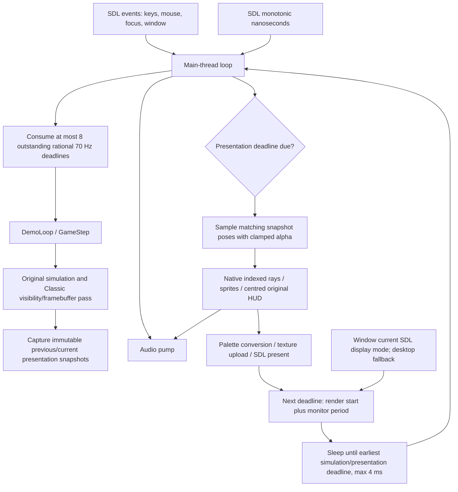

# Milestone 8: high-refresh presentation

Status: implementation complete; local verification results below. PR #11 stays draft;
physical high-refresh and audio output measurements are still required.
No changes to WOLFSRC, game assets, gameplay RNG, movement, collision, combat
or enemy thinkers are part of this milestone. No new backend or audio thread.

## Architecture and exact behaviour



The simulation scheduler consumes each deadline exactly once, using integer
rational 70 Hz conversions instead of a rounded 14 ms timestep. The eight-tick
batch limit bounds work between event polls; remaining debt stays in
`completed_tick` and is consumed on subsequent iterations. Simulation time is
never advanced merely because a presentation frame was drawn. Events are
sampled once per outer iteration; held controls apply to subsequent ticks,
press edges and mouse deltas are consumed by the original per-tick input path.
Input events are not retroactively timestamped through a stall.

Classic keeps its original authoritative renderer, framebuffer, and 4 ms outer
sleep, with no interpolation. It intentionally shares the exact deadline
scheduler: returning to the old outer-clock call would reintroduce `MAXTICS`
debt truncation after stalls and mode-switch ambiguity. `GameStep` retains its
legacy bounded elapsed-time API for existing direct callers; the application
passes individual deadlines. Paused/menu/fade ticks continue to run the UI,
not gameplay. Save/load and resume rebase the game's clock and snapshots.
Original demos still consume a command every **four** 70 Hz ticks, including
their original four-tic movement, AI and RNG semantics.

Smooth Rendering is active only with High Resolution. The Display menu has
**no manual FPS selection**, and config output has no `presentation_fps` key.
Old TOML files may contain that unknown key; it is ignored on load and removed
on the next valid save, while `smooth_rendering` is preserved. Invalid/future
configuration files retain their existing preservation policy.

The video platform queries `SDL_GetCurrentDisplayMode` for
`SDL_GetDisplayForWindow(window)` each scheduling iteration. Invalid/missing
refresh values fall back to the desktop mode, then 60 Hz. Rates are continuous
floating point values (59.94 Hz is not rounded to 60), capped at 240 FPS.
No table of supported refresh presets is used. Changing displays, fullscreen
mode, or refresh updates the next deadline immediately; Auto desktop render
size continues to use the existing staged surface allocation/retry path.

Presentation deadlines use a fresh timestamp after simulation, anchored at
render start. Rendering/upload/present time is subtracted from the available
period; an over-budget frame becomes immediately eligible without replaying
missed frames. When SDL reports VSync enabled and the last present blocked for
at least half a monitor period, VSync owns monitor pacing and software enforces
only the 240 FPS ceiling. Nonblocking/unsupported VSync retains the monitor
software limit. There is no extra full-period sleep after a blocking present.
Sleep is bounded to 4 ms for input and audio service; it does not busy-spin.
VSync/VRR/compositor behaviour still requires physical display validation.

## Snapshot audit and corrections

Snapshots contain camera position/angle; actor allocation identities, poses,
sprite state and facing; door geometry/positions; tiles/statics; pushwall state;
weapon frame; level/view identity; ceiling colour; death phase/cursor; and
instantaneous death/victory/demo flags. The original HUD/framebuffer and palette
are composited live so pickups, weapon animation and UI events remain instant.
The renderer reads presentation data without writing authoritative objects,
visibility, clock, palette, input or RNG.

Sampling adds one simulation interval of latency and clamps alpha to [0,1].
Normal play interpolates between 70 Hz captures; demos between four-tic command
captures. Camera and actor facing use the shortest angle arc. Allocation
identities prevent blending newly spawned/reused slots; removed actors vanish
immediately. Sprite state changes are instantaneous. Large position jumps,
level/view changes, regressing clocks, load/resume, death/respawn and demo
transitions snap/reset rather than interpolating unrelated states. Death
rotation can interpolate; the fizzle and victory presentation remain discrete.

Corrections made after reviewing all 21 original PR commits:

- New or replaced door indices snap unless both snapshots match geometry,
  orientation and lock. They previously blended against unrelated old data.
- Pushwalls interpolate only within the same tile or a valid cardinal crossing.
  At a crossing, only affected pushwall/reservation cells rewind; the previous
  whole-map copy could resurrect a just-opened door or unrelated changed tile.
- Actor facing now interpolates across direction wrap. Ceiling, death progress
  and overlay flags come from the supplied snapshot rather than the live world.
- Frame pacing uses fresh render-start timestamps, preserves fractional monitor
  rates, falls back from invalid current modes, and accounts for blocking VSync.
- Sky/floor are filled by contiguous rows. Wall spans alone use column writes,
  with a reciprocal texture scale instead of division for every wall pixel.
  Original wall intersections, texture pages and Classic drawing are unchanged.

The original PR's groundwork, integration, refresh-policy, menu/config and
regression commits were all inspected, including the intermediate split changes
and the malformed literal-newline HUD comment later fixed by its integration
commit. Review range: `89cfdf8` through `7cc05a3`, 21 commits, relative to the
PR base `origin/master` at the start of this work.

## HUD and native geometry

Palette index 127 fills the full native gameplay scene, including status-bar
side gutters. The centred original 4:3 status artwork is then copied unchanged.
Native bevels frame the world viewport. Letterboxing outside the selected
scene remains black. Tests compare every HUD/gutter pixel across all five
aspects (4:3, 16:9, 16:10, 21:9, 32:9), all fixed render presets and larger
canvases, plus the original framebuffer hash oracle. Window resizing, tiny
windows, fullscreen, Auto desktop resolution, filtering, death/respawn,
allocation failures and transactional display-setting failures have SDL tests.

## Reproducible validation

All commands use owned WL6 assets externally; no commercial assets or captures
are committed. Build artifacts and raw logs are under ignored `build/checks/`.

```sh
export WOLF3D_DATA="$HOME/.steam/steam/steamapps/common/Wolfenstein 3D/base"
export SDL_SDK=../cart/vendor/SDL

gcc -std=c11 -O2 -Wall -Wextra -Wpedantic -Wconversion -Wshadow -Werror \
  -Isrc -I"$SDL_SDK/include" src/main.c src/engine/*.c src/platform/*.c \
  "$SDL_SDK/build/libSDL3.a" -pthread -lm -o build/checks/wolf3d-revive-m8
WOLF3D_BINARY="$PWD/build/checks/wolf3d-revive-m8" \
  python3 -m unittest discover -s tests -v

# Instrument the full app as well as the harnesses; the SDL static SDK is not
# itself sanitizer-instrumented.
gcc -std=c11 -Wall -Wextra -Wpedantic -Wconversion -Wshadow -Werror \
  -fsanitize=address,undefined -fno-omit-frame-pointer -g \
  -Isrc -I"$SDL_SDK/include" src/main.c src/engine/*.c src/platform/*.c \
  "$SDL_SDK/build/libSDL3.a" -pthread -lm -o build/checks/wolf3d-revive-m8-asan
SANITIZE=1 CC="gcc -O1" UBSAN_OPTIONS=halt_on_error=1 \
  WOLF3D_BINARY="$PWD/build/checks/wolf3d-revive-m8-asan" \
  python3 -m unittest discover -s tests -v
```

Validation on 2026-11-03 (Australia/Adelaide):

| Check | Result |
| --- | --- |
| GCC C11 `-O2`, conversion/shadow/pedantic warnings, `-Werror` | Passed, full application and profiling harness |
| CART `cart-sdl` build | Passed |
| Application Smooth Rendering smoke, three fixed resolutions, VSync off/on, old FPS key | All six passed; migration persisted |
| Complete Linux suite, owned Steam WL6 | **119 tests passed**, 454.182 s |
| Complete ASan/UBSan suite, harnesses `-O1`, instrumented full app | **119 tests passed**, 993.598 s; no sanitizer findings |
| DOS reference, Classic and interpolated native pass | **5,386/5,386 match** in each Linux path |
| Classic framebuffer hash oracle | Exact reference match |
| Configuration persistence/obsolete FPS migration | Passed |
| Eight refresh rates / 140-tick save equivalence | Passed, 60/75/90/120/144/165/180/240 |
| MinGW x86_64 full application and renderer/demo harnesses, `-Werror` | Passed (SDL 3.4.18 development SDK) |
| Wine `--check-level`, owned renderer/Auto/fullscreen/failures/audio | Passed |
| Wine rational clock, interpolation at all eight rates and save equivalence | Passed |
| Wine interpolated DOS reference | **5,386/5,386 match**, counts 691/1899/1140/1656 |
| Native Linux X11/OpenGL renderer/resize/fullscreen, all 60 maps | Passed |
| HUD visual inspection | 16:9 and 32:9 captures inspected; teal gutters, centred artwork and bevels correct |

Logs: `m8-suite.log`, `m8-asan-final-suite.log`, `m8-wine-complete.log`, `m8-native-final.log`,
`m8-presentation-final.log`, `m8-presentation-final-asan.log`,
`m8-wine-presentation-final.log`, `m8-render-final.log`,
`m8-render-final-asan.log`, and `m8-main-smoke.log` under `build/checks/`. Synthetic interpolation
covers slot reuse/removal, unmatched doors, all cardinal pushwall crossings
and stops, teleports, angle wrap, death, pause/resume, load and level resets.
Tests retain exact original four-tic demo state and byte-identical game saves
across independent render rates.


## Benchmark harness

`tests/presentation_benchmark.c` measures four seconds per canvas at 640×480,
1280×720 and 1920×1080, view 19, owned E1M1, including simulation, main-thread
audio, indexed rendering, RGBA conversion, upload and SDL present. It reports
actual elapsed FPS, mean/p95/p99 interval, variance, CPU, processed/due ticks,
game clock, allocations and audio empty-queue observations. Optional profiling
is compiled out of normal builds. Capture cost is amortised per presentation;
sampling, rays/walls, sprites, conversion, upload and present have separate
counters. Linked SDL allocation calls are observed by the optional linker wrappers.
The frame path allocates no engine surfaces after warmup; SDL may allocate.

```sh
gcc -std=c11 -O2 -Wall -Wextra -Wpedantic -Wconversion -Wshadow -Werror \
  -DWOLF3D_BENCHMARK -DWOLF3D_ALLOC_PROFILE \
  -Isrc -I"$SDL_SDK/include" tests/presentation_benchmark.c \
  src/engine/*.c src/platform/*.c "$SDL_SDK/build/libSDL3.a" -pthread -lm \
  -Wl,--wrap=malloc,--wrap=calloc,--wrap=realloc \
  -o build/checks/presentation-benchmark8
SDL_VIDEODRIVER=dummy SDL_RENDER_DRIVER=software SDL_AUDIODRIVER=dummy \
  build/checks/presentation-benchmark8 "$WOLF3D_DATA"
```

The optional second argument overrides the harness target for synthetic rate
experiments only. It is not a player setting or proof of a monitor's refresh.
Set `M8_VSYNC=1` to request VSync; a backend that rejects it fails the harness
explicitly. Remove dummy driver overrides for a native desktop measurement.

## Measured results

Host: 13th Gen Intel Core i5-1340P, Linux, reused sibling SDL static SDK.
Native desktop: X11/OpenGL, SDL-reported **59.880 Hz**, 1280×720 window;
SDL dummy audio. Software path: dummy video/software renderer, 60 Hz fallback.
Four seconds per canvas after at least 300 ms / 20 frames of cache and fade
warmup. ASan regressions were running concurrently on other cores; thermal,
compositor and scheduling load affect these short measurements. These are
observed present-call rates, not measurements of scanout or motion-to-photon
latency. No physical high-refresh display was available.

| Path | Canvas | Actual FPS | Mean ms | p95 ms | p99 ms | Variance ms² | CPU % |
| --- | --- | ---: | ---: | ---: | ---: | ---: | ---: |
| X11, VSync off | 640x480 | 59.19 | 16.877 | 18.231 | 18.817 | 0.7760 | 21.0 |
| X11, VSync off | 1280x720 | 59.22 | 16.872 | 19.264 | 21.166 | 2.5923 | 45.7 |
| X11, VSync off | 1920x1080 | 57.63 | 17.351 | 21.008 | 24.116 | 3.3509 | 76.8 |
| X11, VSync on | 640x480 | 59.94 | 16.682 | 17.603 | 18.353 | 0.4541 | 15.9 |
| X11, VSync on | 1280x720 | 59.90 | 16.683 | 17.644 | 17.925 | 0.5228 | 38.3 |
| X11, VSync on | 1920x1080 | 56.36 | 17.743 | 23.775 | 25.578 | 7.0127 | 78.6 |
| Dummy/software | 640x480 | 59.49 | 16.808 | 18.006 | 19.406 | 0.9115 | 53.5 |
| Dummy/software | 1280x720 | 59.49 | 16.809 | 18.070 | 18.873 | 1.0664 | 36.9 |
| Dummy/software | 1920x1080 | 56.65 | 17.652 | 18.633 | 19.187 | 0.3393 | 100.2 |

Additional **diagnostic target overrides**, same 59.88 Hz desktop, VSync off:
these measure presentation-call capacity, **not high-refresh scanout**. Neither
144 nor 240 FPS was sustained at the corresponding requested target.

| Harness target | Canvas | Actual FPS | Mean ms | p95 ms | p99 ms | Variance ms² | CPU % |
| --- | --- | ---: | ---: | ---: | ---: | ---: | ---: |
| 144 | 640x480 | 139.06 | 7.183 | 8.658 | 9.602 | 1.0245 | 55.1 |
| 144 | 1280x720 | 124.64 | 8.022 | 12.521 | 13.941 | 3.6375 | 92.3 |
| 144 | 1920x1080 | 70.90 | 14.105 | 21.240 | 23.985 | 9.3986 | 99.8 |
| 240 | 640x480 | 213.41 | 4.686 | 5.971 | 6.731 | 0.5531 | 88.3 |
| 240 | 1280x720 | 138.96 | 7.196 | 12.356 | 13.678 | 5.2090 | 100.2 |
| 240 | 1920x1080 | 71.31 | 14.023 | 22.729 | 25.943 | 16.3265 | 100.1 |

Raw logs: `m8-native-target144.log`, `m8-native-target240.log`. The product
still derives its rate automatically; only the benchmark harness accepts an
override. All six runs preserved exact processed game-tick counts, retained at
most one outstanding tick at exit, and observed zero empty audio queues.

Component means, X11 VSync off, milliseconds amortised per presentation:

| Canvas | Rays + walls | Sprites | Capture | Sample | RGBA convert | Upload | Present |
| --- | ---: | ---: | ---: | ---: | ---: | ---: | ---: |
| 640x480 | 0.6102 | 0.5024 | 0.0078 | 0.0059 | 0.5151 | 0.2843 | 0.2253 |
| 1280x720 | 2.1129 | 0.5484 | 0.0079 | 0.0059 | 1.4925 | 0.7576 | 0.2446 |
| 1920x1080 | 4.2321 | 0.5525 | 0.0078 | 0.0054 | 3.0173 | 1.1494 | 0.2161 |

The 640×480 VSync run spent 14.29 ms in present and achieved 59.94 FPS;
1280×720 spent 9.41 ms and achieved 59.90 FPS. This verifies that the tested
blocking path does not add a second monitor-period wait. At 1920×1080 this
machine did not sustain monitor refresh in these runs. Higher targets are
therefore not claimed at 1080p. The initial scene-only 20-pass runs measured
9.55 ms before and 6.24 ms after the wall-fill optimisation; those are short
microbenchmarks, not end-to-end performance guarantees.

Every measured game-clock increment exactly equals the processed deadline
count (279 or 280 ticks per four-second measurement). At exit, zero or one
additional tick was due: this is outstanding scheduler debt immediately after
the final render/wait, not a discarded tick. Exact long-term 700 ticks per
10 seconds and bounded stall-debt consumption are separately asserted by the
clock regressions. The application does not flush gameplay debt on shutdown.

Peak child RSS, including warmed SDL/driver allocations over all three canvases:
176,524 KiB X11 VSync off; 170,140 KiB X11 VSync on; 30,588 KiB dummy/software.
Persistent indexed + RGBA surface budgets are 1,536,000 / 4,608,000 / 10,368,000
bytes, plus texture/depth/snapshot storage. The X11 VSync-off run intercepted
3,570 / 3,102 / 2,522 allocation calls over each four-second interval. These
include statically linked SDL calls; dynamically loaded driver/libc-internal
allocations are outside the linker wrappers. Engine surfaces are reused, but
the overall SDL frame path is not allocation-free. CPU is process CPU time,
including SDL threads; 100% corresponds to one fully occupied logical CPU.

Raw benchmark and RSS records are `m8-native-benchmark.log`,
`m8-native-vsync-benchmark.log`, `m8-benchmark60-final.log`, and their matching
`*-memory.log` files. Captures stay in ignored `build/checks/m8-native/`.

## Audio findings and remaining limits

All fifteen full-path measurements observed **zero empty SDL input queues**.
The owned renderer stress serviced audio 888 times across long frames with
zero empty queues; maximum observed gaps in the final audio-active transition runs were
2.40 ms native X11 and 3.05 ms Wine. The 60 ms unserviced stall emptied the deliberately short 24 ms control
queue, while the production 80 ms queue retained audio. Existing regressions
also cover music/effects playback, focus and pause/resume state, and repeated
SDL lifecycle. Owned renderer tests now keep audio active across resizing and
fullscreen changes, closing/reopening audio around complete SDL recreation
in the same order as the application. The effect-request test measured
**80.00 ms** of existing input audio queued before synthesis; device/OS
latency is additional. These tests justify retaining the main-thread producer.

The main-thread producer retains an 80 ms floor, two device periods plus 8 ms
headroom, and a 250 ms maximum. Rendering services audio between bounded ray,
sprite, conversion and fizzle batches, and before/after presentation. No audio
thread was introduced. A device/OS stall longer than the bounded queue can
still underrun; the producer cannot service audio during a blocking driver call.
An empty SDL input queue is an observation, not a hardware underrun counter.

Actual speaker input-to-sound latency and physical underruns cannot be inferred
from dummy audio queues. Queue depth implies latency as well as stall tolerance;
a listening/loopback test on the user's output device remains necessary.
Physical 75–240 Hz, multi-monitor migration, live refresh changes, VRR,
other fullscreen compositors, focus/pause transitions with real audio, and physical
Windows hardware remain acceptance checks. Synthetic rate and SDL transition
regressions do not establish those hardware results. No 144 or 240 FPS
performance guarantee is made.
